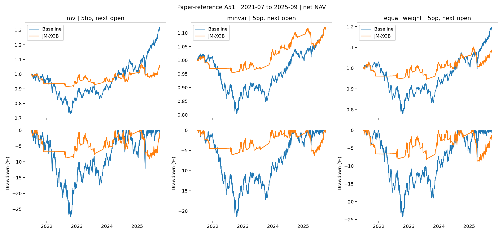
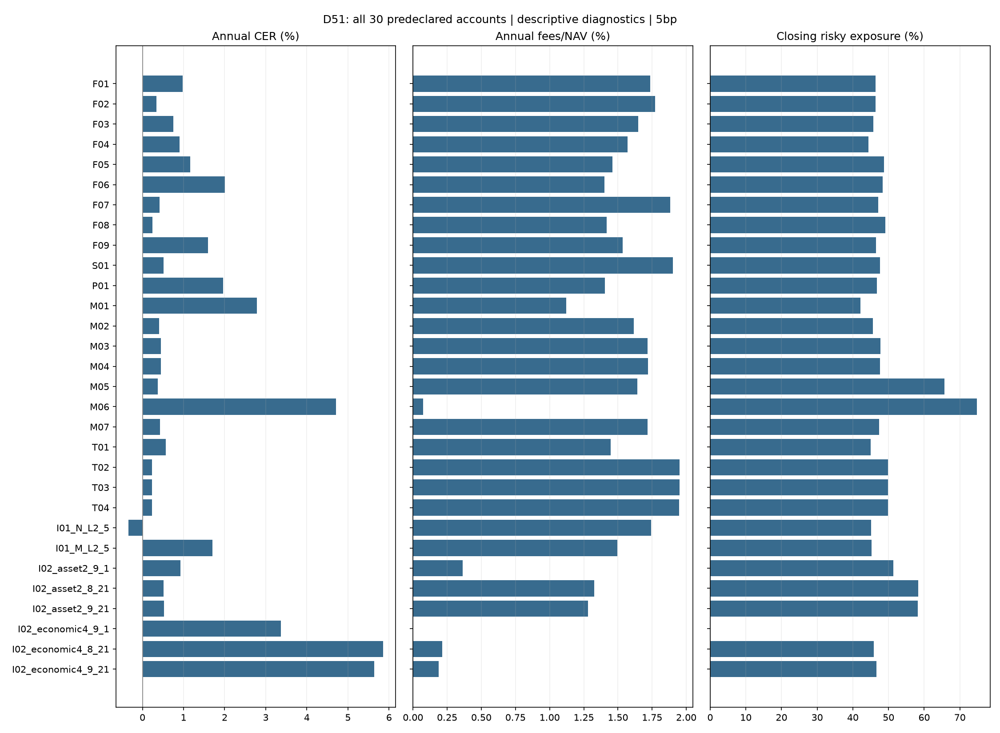

# 국면 예측을 활용한 글로벌 ETF 자산배분

**Shu·Yu·Mulvey 원문 실증에 맞춘 배분 전후 비교와, 국면 정의·ML·거래 정책을 분리한 Python 포트폴리오 연구**

[원문](https://arxiv.org/html/2406.09578v2) · [원문형 전체 실증](docs/redesign-paper.md) · [30개 진단](docs/redesign-diagnostics.md) · [141개월 후속](docs/followup.md)

**목차:** [원문 대응](#원문-대응) · [원문형 실증](#원문형-실증) · [국면·ML 통제 비교](#국면ml-통제-비교) · [원인 진단](#원인-진단) · [장기 후속](#장기-후속) · [데이터 명세](#데이터-명세) · [검증 방법론](#검증-방법론) · [결론](#결론) · [재현](#재현)

## 원문 대응

- **질문:** JM–XGBoost를 넣으면 기본 MV·MinVar·동일가중의 수익·샤프·낙폭이 함께 개선되는가?
- **A51 원문 준거:** 실제 ETF8개·BIL, 2021.07–2025.09 **51개월**, **11년 학습·5년 검증·6개월 갱신**, 일별 판단·다음 시가 체결·편도5bp.
- **같은 점:** 저자 Jump Model·수익8/시장5 입력·XGB 기본 용량·다음 날 국면·현금 규칙·원문형 평균분산 목적함수.
- **다른 점:** 원문12개 지수·2007–2023년204개월과 자료·기간·현금·체결 시점이 다르다. XGB 버전·약세 평균 제한 등 미확정 항목을 [대응 감사](results/redesign/paper_fidelity_reviewed.json)에 공개한다.
- A51은 예측·평균 추정·위험회피·거래벌점·현금 규칙의 묶음 비교다. **XGB 단독 추가 가치는 B51의 동일 배분 내 LR 비교로 판단**한다.

## 원문형 실증

| 배분 | 원문 샤프 | ETF 샤프 | ETF 연 BIL 초과수익 | ETF 최대낙폭 |
|---|---:|---:|---:|---:|
| 평균분산·하한 | 0.37 → 1.02 | 0.30 → -0.25 | 4.15% → -1.77% | -27.40% → -9.15% |
| 평균분산·상한 | 0.37 → 1.02 | 0.30 → -0.24 | 4.15% → -1.66% | -27.40% → -9.15% |
| 최소분산 | 0.70 → 1.12 | -0.05 → -0.15 | -0.37% → -0.63% | -21.43% → -6.32% |
| 동일가중 | 0.51 → 0.91 | 0.13 → -0.19 | 1.42% → -1.21% | -24.23% → -8.85% |

- **관찰 결과:** 세 배분 모두 낙폭은 감소했으나 원문과 같은 수익·샤프 개선 방향은 유지되지 않았다. 원문 수치와 ETF 수치의 차이를 직접 유의성 검정하지 않는다.
- **실제 노출·비용:** MV는 평균 종가 위험노출 100.0% → 47.5%, 연 비용/NAV 0.10% → 1.72%. 위험 축소와 매매 부담을 함께 평가한다.



| ETF | B&H 샤프 | JM 유지 샤프 | JM–XGB 샤프 | JM–XGB 최대낙폭 |
|---|---:|---:|---:|---:|
| SPY | 0.56 | 0.18 | 0.78 | -14.82% |
| EFA | 0.29 | -0.20 | -0.44 | -21.98% |
| EEM | -0.01 | -0.35 | 0.07 | -12.09% |
| IEF | -0.57 | -1.03 | -0.44 | -6.19% |
| TLT | -0.60 | -0.81 | -0.86 | -16.06% |
| LQD | -0.40 | -0.83 | -0.68 | -10.96% |
| IYR | -0.00 | -0.30 | 0.01 | -13.20% |
| GLD | 1.04 | 0.18 | 0.28 | -12.07% |

- JM 유지 기준은 XGB가 선택한 벌점을 공유한다. 모든 ETF를 독립적인 투자 표본으로 세지 않는다.
- **표7 대응:** 다음 날 종가 간 초과수익 IC의 자산별 단순 평균은 EWMA -5.46%, JM–XGB 하한 -0.61%, 상한 -0.45%다. 현금 대피일을 포함한다. 원문의 Overall 집계와 같은 지표라고 주장하지 않는다.
- [개별 ETF·구간별 성과](results/redesign/paper_table4.csv) · [전체/원문중첩30개월/이후21개월](results/redesign/paper_table6.csv) · [자산별 IC·체결 이후 진단](results/redesign/paper_table7.csv)

## 국면·ML 통제 비교

| 평가 | 주요 CER 비교 | 연 CER 차이 | 가족 내 동시95% 구간 | 판정 |
|---|---|---:|---:|---|
| B51 | 자산2 XGB − 경제4 XGB | -3.20%p | [-6.86, +0.46]%p | 우위 미확인 |
| B51 | 자산2 XGB − 자산2 LR | +0.10%p | [-1.71, +1.91]%p | 우위 미확인 |
| B51 | 경제4 XGB − 경제4 LR | +1.26%p | [-0.24, +2.76]%p | 우위 미확인 |
| F141 | 자산2 XGB − 경제4 XGB | -3.21%p | [-5.28, -1.14]%p | 오른쪽 우위 |
| F141 | 자산2 XGB − 자산2 LR | +0.58%p | [-0.98, +2.15]%p | 우위 미확인 |
| F141 | 경제4 XGB − 경제4 LR | -0.73%p | [-1.67, +0.21]%p | 우위 미확인 |

- B51은 같은51개월·11년/5년, F141은141개월·5년/3년·별도 거래 정책이다. 두 가족의 구간을 합쳐6개 전체 동시95%라고 부르지 않는다.

## 원인 진단

- **사전 고정한30개 D51 계정:** 분류기 창/입력/가중치/용량, 평활·선택창·5년 파이프라인, 평균·현금·공분산, 비용 범위·계획기간·밴드 및 두 상호작용을 같은51개월에 비교했다.
- 고정된 A 선택 경로의 조건부 진단과 새 선택·파이프라인 묶음을 구분한다. 모든 결과를 공개하며 좋은 진단을 주 전략으로 승격하지 않는다. [선언한 변경과 실제 차이](results/redesign/diagnostic_contrasts.csv)



## 장기 후속

- 원문 조건을 변경한 F141은 **2014.01–2025.09, 141개월**이다. 경제4 XGB가 자산2 XGB보다 CER가 높았지만, 두 국면 모두 XGB의 LR 대비 우위는 확인되지 않았다.
- 비용·평균 추정·현금 정책에 따라 순위가 달라진다. [기존69개 계정·모든 정책·검정력·한계](docs/followup.md)를 보존한다.

## 데이터 명세

- **위험자산:** SPY·EFA·EEM·IEF·TLT·LQD·IYR·GLD, 실제 현금 BIL. 미국 상장·달러 기준, Yahoo 일별 조정 시가/종가·분배금·분할. 상장 전 합성 이력 없음.
- **시장:** FRED DGS2 변화·T10Y2Y 수준/변화·VIX 변화·SPY–IEF 상관. DGS3MO는 피처/평균/공분산 초과수익 기준이며 실제 현금 수익과 구분한다.
- **경제4:** ALFRED INDPRO·CPIAUCSL 첫 공동 완성 빈티지의 YoY 3개월 대3개월 모멘텀. 가용일·관측시차 보존, 날짜만 있는 공개자료는 한 거래일 지연.
- **감사:** URL·수집 시각·SHA-256·실제 일별 빈도·기업행사·NYSE 거래일 검사. 2025년10월 CPI 결측 이전인2025-09로 종료를 고정했다. [전체 자료 명세](docs/data.md)
- FRED 시장 이력은 최신 제공 이력에 지연을 적용한 자료다. 조정 가격의 분배금 재투자, 세금·실제 슬리피지 생략을 명시한다.

## 검증 방법론

- **롤링 워크포워드:** 과거 학습창·당시의 표본 밖 검증 예측만 사용해 다음6개월을 예측하고 이동한다. 표준화는 학습창 안에서 적합한다.
- **정보·회계:** 종가 후 판단→다음 조정 시가 체결→종가 평가. 기존 보유분의 야간 손익·실제 비중 드리프트·9개 ETF 편도 비용·자기금융 NAV를 같은 엔진으로 계산한다.
- **새 진단 독립 검증:** 3개 경계·8개 ETF·11개 새 학습 경로의 **264건** 캐시 없는 재적합, 선택 144건 재계산, **31개** 계정 전체 수량 재생(A0 포함)·미래 교란·목적값 상한 검사를 통과했다.
- **통계:** 월 CER(위험회피5), 월 쌍체 블록20,000회·6개월 기본/3·12개월 민감도·주요3개 max-T 동시95%. D51은 설명용이며 새 우승/유의성 검정을 하지 않는다.
- [분석 계약](configs/report_analysis_contract.json) · [진단 실행 계약](configs/diagnostic_execution_contract.json) · [실제 자료 검증](results/redesign/verification.json). 이전 결과를 열람한 역사적 후속 연구이며 전향 검증이 아니다.

## 결론

- **원문 재현 방향:** 이 ETF 표본에서는 낙폭 감소를 확인했으나, 원문과 같은 세 배분의 수익·샤프 동반 개선은 유지되지 않았다.
- **예측→투자성과:** 예상수익 IC 개선만으로 비용 차감 샤프 개선을 보장하지 않는다. 노출·평균 추정·거래 정책을 분리해 해석해야 한다.
- **ML 추가 가치:** XGB의 LR 대비 우위는 B51·F141 모두 확인하지 못했다. 우위 미확인은 동등성이나 무효과의 증거가 아니다.

## 재현

```bash
uv sync --frozen --python 3.12
uv run etf-study acquire
uv run etf-study audit
uv run etf-study run --workers 4
uv run etf-study verify
uv run etf-study followup run --workers 4
uv run etf-study followup verify --workers 4
uv run python -m etf_regimes.redesign_analysis run
uv run python -m etf_regimes.redesign_analysis verify
uv run python -m etf_regimes.redesign run --workers 4
uv run python -m etf_regimes.redesign_packaging package
uv run python -m etf_regimes.redesign verify --workers 4
uv run python -m etf_regimes.redesign report
```

- 결과만 검증하려면 [복원·공개 CI 절차](docs/redesign-diagnostics.md#재현과-검증)를 따른다. 실행 계약의 원자료 해시가 다르면 새 다운로드를 조용히 대체하지 않고 중단한다.
- **구현:** Python3.12 · 저자 Jump Model(커밋 고정) · scikit-learn · XGBoost2.1.4 · CVXPY/OSQP · pandas. [연구 명세](docs/redesign-plan.md) · [검수 기록](docs/redesign-review.md)
