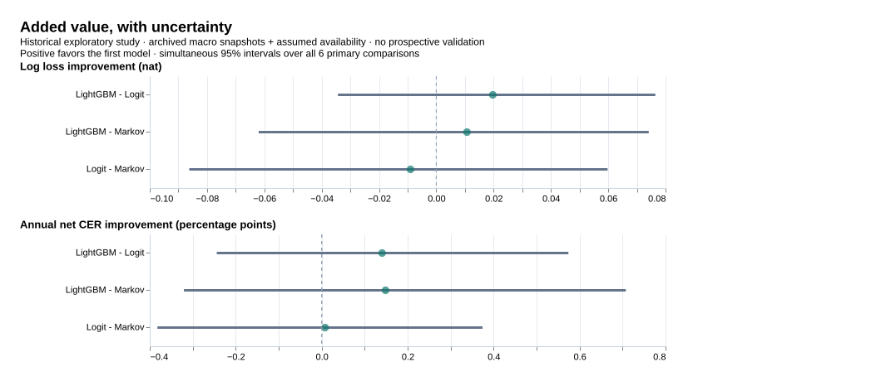
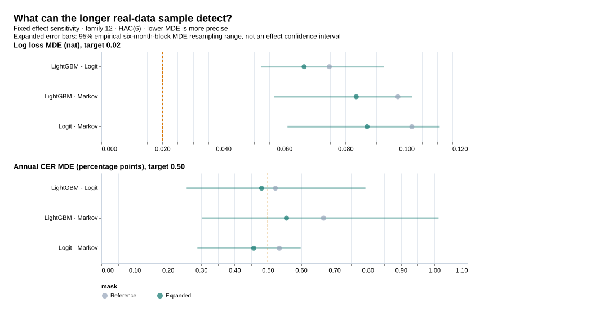
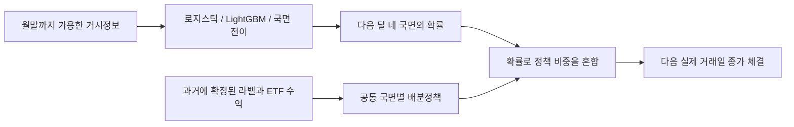
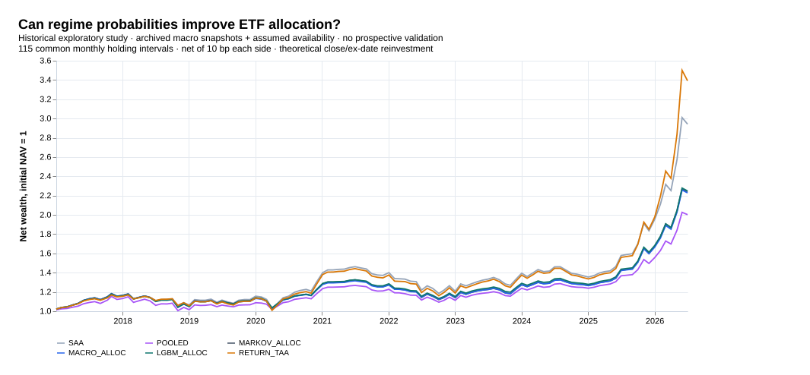

# 한국 4국면 예측과 자산배분

**다음 달의 성장·물가 국면을 예측하면, 한국 주식·국채 배분이 실제로 나아지는가?**

골디락스·오버히트·리세션·스태그플레이션의 확률을 예측하고, 그 확률을 ETF 비중으로 연결한 실증 연구다. **규제 로지스틱과 LightGBM을 동등한 주 모형으로 비교**한다. 예측을 잘하는지와 돈을 더 잘 배분하는지를 각각 검증한다.

- **장기 자료:** 1990년부터의 산업생산·CPI 지수, 1991년부터 구성 가능한 거시 입력. 수정치 기반 장기 예측 평가는 **2001-10–2026-07, 298개월**.
- **표본 확대 재검증:** 예측 237개월·실제 ETF 배분 140개월, 기존 결과와 같은 구간의 확률 일치·12개 비교 보정.
- **기존 고정 비교:** OECD 월별 아카이브 **333개**로 당시 성장·물가 정보를 복원. 공통 예측 **201개월**, 실제 ETF 배분 **115개월**.
- **공정한 ML 비교:** 같은 입력·가용 시점·내부 검증·정책·체결·비용. 주 비교 6개의 불확실성을 함께 보정.
- **연구 상태:** 실제 자료에 근거한 역사 탐색 연구. 아카이브 가용일 가정과 일부 시장변수의 수정치 사용이 남아 있으며, 전향 검증을 마친 성과가 아니다.

## 무엇을 발견했나

- LightGBM 로그손실은 **1.402**, 단순 과거 빈도는 **1.389**다. 이 표본에서 ML이 가장 단순한 확률 기준도 넘지 못했다.
- LightGBM 배분의 순 CAGR은 **8.82%**, 연 순 CER은 <strong>6.43%</strong>다. 50/50 정적 배분의 <strong>11.92% / 7.80%</strong>보다 낮았다. 주식 노출과 위험도 달라 수익률만으로 원인을 단정하지 않는다.
- 발표 시차도 크다. 이번 아카이브 가용 가정에서 최근 알려진 국면과 예측 타깃은 **4–5개월** 떨어져 있다. 완료 에피소드 71개 중 51개는 첫 라벨의 가용 시점에 이미 끝나 있었다. 이 사후 진단은 **OECD 판에 둔 지연 가정**의 결과이며 국내 최초 발표의 실제 지연을 뜻하지 않는다.

**LightGBM 대 국면 전이:** 국면 예측과 배분 효용의 추가 가치를 확인하지 못했다.

**LightGBM 대 로지스틱:** 국면 예측과 배분 효용의 추가 가치를 확인하지 못했다.

| 비교: 앞 모형−뒤 모형 | 로그손실 개선 [동시 95% 구간] | 연 순 CER 개선 [동시 95% 구간] |
| --- | --- | --- |
| 로지스틱 - 국면 전이 | -0.009 [-0.086, 0.060] | 0.01%p [-0.38%p, 0.37%p] |
| LightGBM - 국면 전이 | 0.011 [-0.062, 0.074] | 0.15%p [-0.32%p, 0.71%p] |
| LightGBM - 로지스틱 | 0.020 [-0.034, 0.076] | 0.14%p [-0.24%p, 0.57%p] |

모든 값은 앞 모형의 개선이 양수다. 로그손실은 nat/월, CER은 연 %p다. 20,000회·6개월 블록 재표집으로 6개 주 비교 전체에 Bonferroni 95% 동시 구간을 적용했다. 구간이 0을 포함하면 개선으로 판정하지 않는다. CER은 위험을 감안한 평균-분산 효용 지표이며 CAGR과 다르다.



## 검정력 한계를 다시 시험한 결과

- 실제 자료의 적격 시작일을 앞당겨 예측 **201→237개월**(2006-09부터), ETF 배분 **115→140개월**(2014-10부터)로 확대했다. 새 월별 손실과 체결 결과를 다시 계산했다.
- 내부 학습 60개·검증 24개·국면별 12개를 유지했다. 확대안의 첫 외부 학습은 87개다. 배분은 공분산 60개월과 가용 라벨/수익 60쌍을 유지한다. 초기 추정 불확실성이 늘어나는 대가가 있다.
- 같은 분산이라면 표준오차는 예측 **7.9%**, 배분 **9.4%** 감소한다. 실제 분산은 기간마다 달라 이 비율을 실제 검정력 향상으로 단정하지 않는다.
- 확대안까지 총 12개 비교를 보정했다. 보정 구간의 하한이 0을 넘은 확대 대비는 **0/6개**다. 고정 최소효과(로그손실 0.02 nat·연 CER 0.50%p)에 대한 HAC(6) 근사 검정력 80% 충족은 **2/6개**다. 같은 12개 보정·HAC(6)으로 비교하면 배분의 80% 근사 기준 충족은 참조 **0/3→2/3**이다. 국면 예측 3개는 모두 부족하다. 분산 추정의 불확실성까지 해결한 것은 아니다.

| 비교 | 지표 | 확대 N | 80% MDE | 고정 최소효과 | 근사 검정력: 참조→확대 | 필요 총 개월 |
| --- | --- | --- | --- | --- | --- | --- |
| Logit - Markov | log_loss | 237 | 0.0870 | 0.0200 | 1.6%→2.2% | 4490 |
| Logit - Markov | annual_CER | 140 | 0.46%p | 0.50%p | 72.7%→88.2% | 118 |
| LightGBM - Markov | log_loss | 237 | 0.0835 | 0.0200 | 1.8%→2.4% | 4132 |
| LightGBM - Markov | annual_CER | 140 | 0.56%p | 0.50%p | 46.5%→68.0% | 174 |
| LightGBM - Logit | log_loss | 237 | 0.0664 | 0.0200 | 3.1%→4.0% | 2615 |
| LightGBM - Logit | annual_CER | 140 | 0.48%p | 0.50%p | 75.2%→83.8% | 130 |

필요 N은 실제 관측한 효과가 아닌 **미리 고정한 최소효과**를 탐지할 표본 수의 정규근사다. 이미 본 역사 자료의 변동성이 앞으로 유지된다는 조건이 붙으며, 전향 검정력 보장이 아니다. [확대 결과·구간·불확실성·모든 민감도](docs/power_retry_results.md) · [결과 전 확대 설계](docs/power_retry_protocol.md)



## 네 국면을 어떻게 정하나

성장은 **산업생산의 전년동월 성장률**, 물가는 **CPI의 전년동월 상승률**로 측정한다. 각각 최근 3개월 평균에서 직전 3개월 평균을 뺀 값으로 방향을 정한다. 두 방향을 조합하며, 성과를 보고 경계나 국면 수를 바꾸지 않는다.

| 국면 | 성장 모멘텀 | 물가 모멘텀 |
|---|---|---|
| 골디락스 | 상승 | 하락 |
| 오버히트 | 상승 | 상승 |
| 리세션 | 하락 | 하락 |
| 스태그플레이션 | 하락 | 상승 |

정확히 0이면 상승으로 분류한다. 여기서 리세션은 **성장·물가 모멘텀의 동반 둔화**를 뜻하며 공식 경기침체 판정이 아니다. 산업생산을 GDP로, 인플레이션 둔화를 물가 지수 하락으로 해석하지 않는다.

## 입력에서 투자 비중까지



- 입력 8개: 성장·물가 모멘텀, 한국 단기금리 3개월 변화, 미국 10년 금리 변화, 원/달러 변화, 원유 변화, 성장·물가 관측월의 나이.
- 각 월말 **18시 KST**에 다음 관측월을 예측한다. 미공개 현재 국면을 이미 아는 것처럼 쓰지 않는다.
- 과거에 확정된 국면별 ETF 수익으로 네 정책 비중을 학습한다. 작은 국면의 평균은 전체 평균 쪽으로 수축한다.
- 세 예측모형은 매월 **동일한 네 정책**을 공유한다. 확률만 달라지므로 예측모형이 배분에 주는 차이를 비교할 수 있다.
- 주식은 30–70%, 나머지는 국채다. 첫 공동 거래 세션 종가 이후의 수익부터 새 비중에 귀속하고, 매수·매도 금액 각각에 기본 10bp 비용을 차감한다.

실제 예: **2020-02 월말** LightGBM의 다음 달 확률은 골디락스 8.3%, 오버히트 15.6%, 리세션 34.6%, 스태그플레이션 41.4%였다. 당시 학습된 정책을 혼합한 주식 비중은 <strong>38.7%</strong>였다. 이는 사후 정답 국면을 넣어 고른 비중이 아니다. [월별 확률](results/four-regime/ARCHIVE/predictions.csv) · [공통 정책](results/four-regime/policies.csv) · [비중](results/four-regime/signals.csv)

## 예측과 배분 성과

**국면 예측: 2009-09–2026-05 판단월, 201개 공통 OOS 사례.**

| 방법 | 로그손실 ↓ | Brier ↓ | 균형 정확도 ↑ | Macro F1 ↑ |
| --- | --- | --- | --- | --- |
| 과거 빈도 | 1.389 | 0.751 | 20.0% | 0.138 |
| 마지막 국면 지속 | 3.535 | 1.472 | 22.5% | 0.225 |
| 국면 전이 | 1.413 | 0.766 | 22.3% | 0.223 |
| 로지스틱 | 1.422 | 0.771 | 16.2% | 0.132 |
| LightGBM | 1.402 | 0.760 | 21.2% | 0.200 |

로그손실은 실제로 발생한 국면에 낮은 확률을 줄수록 커진다. 과신한 오답도 벌점에 반영된다. 네 국면에 항상 25%씩 주면 로그손실은 약 1.386이다. 높은 단순 정확도만으로 모형을 평가하지 않는다. ‘국면 전이’는 마지막으로 알 수 있었던 국면에서 목표월까지 필요한 횟수만큼 전이시킨 기준모형이다.

**ETF 배분: 2016-11–2026-05 판단월, 115개 공통 체결 구간.**

| 전략 | 순 CAGR | 연 순 CER | 일별 MDD | 평균 주식 비중 |
| --- | --- | --- | --- | --- |
| 50/50 정적 | 11.92% | 7.80% | -20.47% | 50.0% |
| 국면 없는 정책 | 7.51% | 5.63% | -15.21% | 36.9% |
| 국면 전이 배분 | 8.78% | 6.28% | -19.07% | 41.6% |
| 로지스틱 배분 | 8.72% | 6.29% | -18.80% | 40.9% |
| LightGBM 배분 | 8.82% | 6.43% | -16.39% | 40.9% |
| 수익률 Ridge | 13.59% | 8.02% | -20.99% | 51.7% |

KODEX 200(069500)과 KODEX 국고채3년(114260)의 실제 종가·분배금을 사용한다. MDD는 일별 경로에서 계산한다. 배당락일 종가 재투자·종가 체결을 가정한 이론적 백테스트이며 실제 주문 체결 기록은 아니다. 보수는 가격에 내재하고 투자자 세금은 제외했다.



## 편향과 과적합을 어떻게 점검했나

- **미래정보:** 학습 라벨과 정책 수익의 가용일을 각각 검사. 미래 아카이브를 바꿔도 과거 입력·학습 행이 달라지지 않는지 실제 자료로 확인.
- **튜닝 누수:** 랜덤 CV 대신 과거 방향 24개 내부 origin. 표준화·후보 선택·확률 온도 보정은 학습 안에서만 수행.
- **과도한 탐색:** 주 학습모형 2개, 기본 후보 각 4개, 온도 3개로 고정. 미리 정한 민감도 전부 공개.
- **기간·사례 선택:** 추가 발표 지연 실험까지 가능한 공통 구간을 결과 전에 고정. 불리한 국면·실패한 전환도 보존.
- **수정치 편향:** 첫 완성 아카이브와 최신치 사이 국면 라벨 <strong>48/332개월(14.5%)</strong>이 달랐다. 수정치만 쓴 장기 성과를 주 아카이브 성과와 구분.
- **참조 설계 감사에서 확인한 표본 차이:** 한 판 추가 지연 부록은 마지막 라벨이 미공개여서 200개월이다. 해당 예측 비교는 기본안도 같은 200개월로 맞췄다. [계획과의 차이·처리](results/four-regime/protocol-deviations.json)를 공개했고 주 분석 201개월의 결과는 바꾸지 않았다.
- **검정력:** 일별 가격 수를 독립 표본 수로 부풀리지 않는다. 개발 구간 MDE와 국면별 에피소드 수를 공개한다. 사전 최소효과를 판별하기에 부족한 비교가 있어 작은 효과에 대한 결론은 제한된다.

이 검사들이 **모든 편향이나 과적합의 부재를 증명하지는 않는다.** 아카이브 판의 과거 배포시각은 가정이며, 시장통제변수 일부는 최신 수정치다. 이전 연구에서 같은 ETF 수익을 이미 봤다. 한국·두 ETF·한 역사 경로에 한정되고, 향후 시점에 미리 기록한 예측으로 재검증해야 한다.

OECD 판의 보수적 가용 가정은 국내 최초 공표보다 늦을 수 있어 실시간 예측 가능성을 과소평가할 수 있다. 따라서 이 결과로 모든 국면 예측 방법이나 더 신속한 국내 원천의 가능성을 부정하지 않는다.

## 재현과 문서

Node.js 24, pnpm 11, 공식 LightGBM 4.6.0 C++ CLI를 사용한다. 연구 코드는 TypeScript다.

```bash
pnpm install --frozen-lockfile
pnpm setup:lightgbm
pnpm check
pnpm verify:published       # 공개 산출물·등록 코드 검증, 원자료 불필요
pnpm verify:power -- --public # 확대 분석 공개 검증
pnpm acquire                # 공식 원천 취득, 원자료는 로컬에 보관
pnpm research               # 등록된 동일 스냅샷으로 전체 실증 재실행
pnpm research:power         # 237/140개월 확대 실험·검정력 민감도
pnpm research:validity      # GDP와의 사후 구성 타당성 대조, 예측모형에 사용 안 함
pnpm verify:research        # 동일 스냅샷·환경에서 실제 입력·예측·체결을 재검증
pnpm verify:power           # 확대 분석의 실제 입력·예측·체결 재검증
pnpm report                 # 검증 후 모든 표·그림·README 생성
```

공급자 자료는 갱신될 수 있다. 취득한 자료의 해시가 [고정 스냅샷](configs/four_regime_sources.json)과 다르면 같은 연구로 실행하지 않고 중단한다. 공개 저장소는 원자료 대신 취득 코드·출처·해시·자체 통계와 모형 산출물을 제공한다. **원자료 취득 없이 과거 실행과 숫자가 완전히 재현된다고 주장하지 않는다.**

| 읽을 내용 | 위치 |
|---|---|
| 결과 해석·전체 부록·민감도·실패 사례 | [연구 보고서](docs/four_regime_results.md) |
| 결과 전 고정한 규칙·변경 근거·잔여 편향 | [실행 계약](docs/four_regime_preregistration.md) |
| 출처·단위·빈티지·가용 시각 | [데이터 사전](docs/four_regime_data.md) |
| 실행 증거·소스 커밋·검증 | [실행 manifest](results/four-regime/manifest.json) · [검증](results/four-regime/verification.json) |
| 확대 실험·검정력·필요 표본 수 | [재시도 결과](docs/power_retry_results.md) · [설계](docs/power_retry_protocol.md) |
| 핵심 구현 | [자료/라벨](src/regimes/data.ts) · [분류/내부 검증](src/regimes/models.ts) · [배분](src/regimes/allocation.ts) · [체결](src/backtest/engine.ts) |

현재 작업 트리에는 4국면 연구의 코드·문서·산출물만 유지한다.
