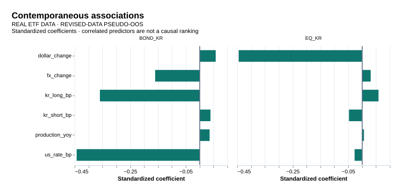
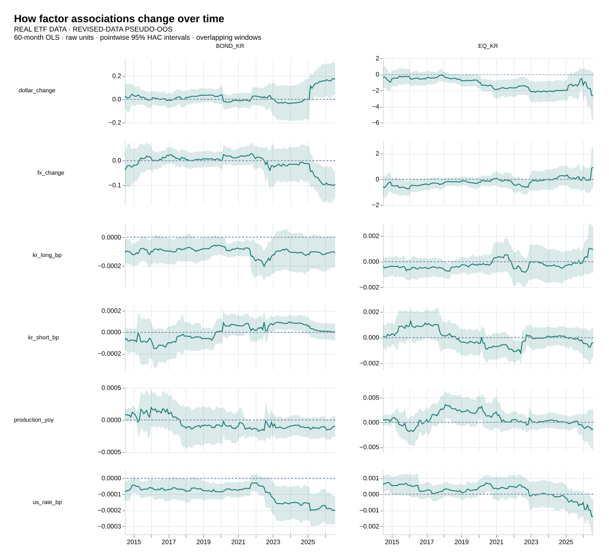
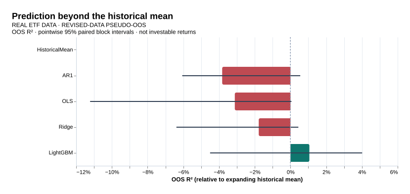
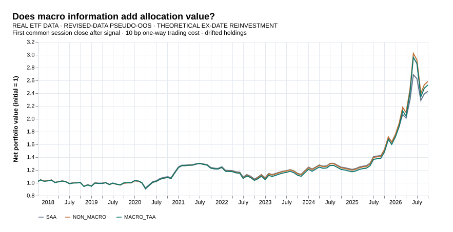
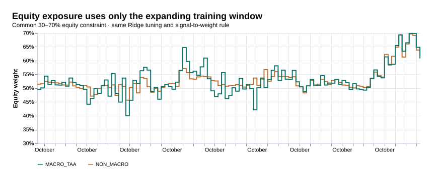
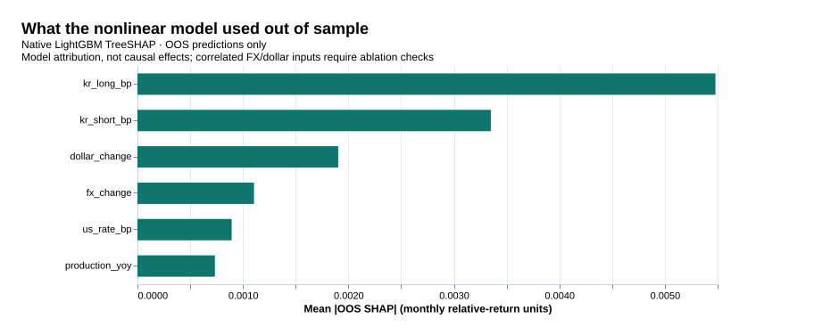
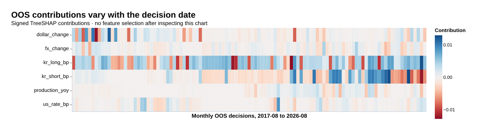

# Korean Macro Factor & Allocation Research

**한국 주식·국채 ETF의 거시금융 팩터를 식별하고, 다음 달 예측과 비용 차감 자산배분까지 검증한 실증 연구.**

- **실제 자료:** KODEX 200·KODEX 국고채3년, OECD·연준/FRED. 공동 거래일 4,240개, 회귀 공통 205개월, 표본 외 평가 109개월.
- **전체 구현:** 데이터 계약 → 정보시점 정렬 → HAC 회귀 → rolling 분석 → walk-forward 예측 → 공정한 배분 비교 → LightGBM·OOS TreeSHAP.
- **핵심 결과:** 대외 팩터의 동시 설명 정보는 확인했다. 다음 달 예측과 거시 배분의 신뢰할 만한 추가 가치는 확인하지 못했다.
- **범위:** 실제 ETF 프록시·최신 수정치 기반 **pseudo-OOS 탐색 연구**. 과거 실시간 빈티지를 복원한 확인 연구나 실거래 성과는 아니다.
- **완료일:** 2026-10-18 KST. [전체 연구 manifest](results/research/study.json) · [실제 결과 검증](results/verification.json) · [실험 원장](docs/experiment_log.md)

## 연구 질문과 수행 범위

| 질문 | 검증 방법 | 결과 |
|---|---|---|
| 국내 요인에 대외 금융여건을 더하면 설명 정보가 늘어나는가? | 동일 표본 국내/전체 회귀, 공동 HAC Wald·Holm | 두 자산 모두 추가 관련성 확인 |
| 팩터 계수는 시간에 따라 안정적인가? | 60개월 rolling, 48·84개월 민감도 | 일부 부호는 안정적이나 크기·다른 계수는 기간 의존 |
| 당시 가용성을 가정한 정보가 다음 달 상대수익을 예측하는가? | 5개 모형의 expanding walk-forward | 평균 대비 확실한 개선을 확인하지 못함 |
| 거시 정보를 추가하면 배분 순성과가 좋아지는가? | 동일 절차의 비거시/거시 전략, 비용·짝지은 구간 | 거시 전략의 점추정치가 더 낮음 |
| 비선형성과 SHAP이 다른 결론을 주는가? | native LightGBM, OOS TreeSHAP·통화 변수 제거 | 작은 MSE 개선은 있으나 불확실 |

- P0는 **축소 진행**: 원래 장기 지수 TR·실시간 빈티지 대신 상장 ETF 총수익률·수정치 기반 검증으로 범위를 등록했다.
- P1–P4 본 연구, P5 국면·배분, P6 ML 부록, P7 문서·재현성 정리를 모두 실행했다. 별도 PDF 보고서는 만들지 않는다.
- 원래 설계와 실행 범위의 차이는 [명세서](korean_macro_factor_research_spec_v2.md), [고정 기록](docs/preregistration.md), [데이터 사전](docs/data_dictionary.md)에 남겼다.

## 데이터와 품질 검증

| 구분 | 실제 원천·정의 | 기간·처리 |
|---|---|---|
| 주식 | KODEX 200, 069500 / KR7069500007 | 운용사 실제 종가 + 배당락일 현금 분배금 |
| 국채 | KODEX 국고채3년, 114260 / KR7114260003 | 쿠폰을 포함한 분배금 재투자 TR; 금리 변화로 대체하지 않음 |
| 국내 팩터 3개 | 산업생산 YoY, 3개월 인터뱅크·10년 국채 금리 변화 | OECD/FRED; 금리는 bp 변화 |
| 대외 팩터 3개 | 미국 10년 금리, 원/달러, 광의 달러지수 | 연준/FRED DGS10·DEXKOUS·DTWEXBGS |
| 현금 비교값 | 3개월 인터뱅크 연율의 ACT/365 단리 환산 | Sharpe 비교용 프록시; 실현 CD 수익률 아님 |
| CPI 보조 분석 | KORCPIALLMINMEI → YoY | 2023-11 종료; 다른 시리즈를 이어 붙이지 않음 |

- **일별:** 2009-07-29–2026-10-16, 두 ETF 공통 4,240 세션. 미완성 2026년 10월은 월간 분석에서 제외했다.
- **월별:** 자산 수익률 2009-08–2026-09, 206개월. 모든 설명변수가 겹치는 회귀 표본은 2009-08–2026-08, **205개월**이다.
- **총수익률:** `TR_t / TR_(t−1) = (종가_t + 배당락일 분배금_t) / 종가_(t−1)`. ETF 보수는 내재하고 투자자 세금은 제외한다.
- **교차 대조:** 외부 서비스와 공통 확인한 종가 약 4,200개씩은 일치했다. 외부 분배금에서 누락된 국채 ETF의 2025-12-12 배당락 **807원**은 운용사 기록으로 보완했다.
- **TR 검증:** 공식 NAV 재투자 차트 약 896개 지점과 비교한 누적 경로 최대 차이는 주식 **0.53%**, 국채 **0.94%**였다. 시장가/NAV 차이가 있으므로 동일한 지수라고 주장하지 않는다.
- **원천 제외:** 운용사 계산기 API의 수익률 경로는 독립된 공식 차트와 약 4.61% 불일치해 사용하지 않았다. 직접 계산한 종가·분배금 TR을 사용했다.
- **공개 범위:** 원본 XLS·가격/분배금·피처 패널은 로컬에 보관한다. 저장소에는 자체 계산 통계·모형 포트폴리오 결과·그림·취득 메타데이터를 공개한다. [품질 기록](results/data-quality.json)

원천 링크: [KODEX 200](https://www.samsungfund.com/etf/product/view.do?id=2ETF01) · [국고채3년](https://www.samsungfund.com/etf/product/view.do?id=2ETF19) · [FRED 시리즈·정확한 단위](docs/data_dictionary.md#거시-팩터)

## 정보시점과 누수 통제

- **판단:** 마지막 공동 거래일 18:00 KST. `available_datetime ≤ decision_datetime`인 버전만 as-of 결합한다.
- **국내 월간 지표:** 관측월 + 2개월 첫날부터 사용 가능하다고 가정한다. 확인하지 못한 실제 발표시각·빈티지는 `null`로 보존한다.
- **미국 금리:** 다음 미국 영업일 공개 가능성을 고려해 예측 입력에 7일 버퍼를 둔다.
- **환율·달러:** [H10은 일별 관측·주별 공개](https://www.federalreserve.gov/releases/h10/)이므로 예측 입력에 14일 버퍼를 둔다. 동시 설명용 월말 시리즈는 별도 ID로 분리했다.
- **학습:** 당시 허용되는 타깃 버전만 사용한다. 스케일링·Ridge alpha·LightGBM 튜닝은 매월 학습 창 내부에서 수행한다. 미래값 backfill·임의 보간은 하지 않는다.
- **한계:** 발표 버퍼가 최신 수정치의 빈티지 편향을 제거하지 못한다. 아래 예측·배분·ML 결과는 모두 **revised-data pseudo-OOS**다.

## 팩터 식별: 설명력과 불확실성

- OLS는 QR로 추정하고 SVD로 rank·condition number를 확인한다. HAC는 Bartlett lag 3, 유한표본 보정 `n/(n−k)`를 사용한다.
- 국내/전체 모형은 자산별 같은 205개월·결측 마스크를 쓴다. H1은 대외 계수 3개의 공동 Wald 검정이며, 두 자산 검정에 Holm 보정을 적용한다.

| 자산 | 국내 조정 R² | 국내+대외 조정 R² | 증가 | 공동 검정 Holm p |
|---|---:|---:|---:|---:|
| 주식 ETF | -1.26% | 14.82% | +16.08%p | 7.98×10⁻⁸ |
| 국채 ETF | 34.19% | 50.19% | +16.00%p | 4.97×10⁻⁶ |

- **주식:** 광의 달러 변화의 전체 표본 표준화 계수는 **-0.444**다. 원/달러와 달러는 상관되므로 개별 기여의 독립적인 순위를 뜻하지 않는다.
- **국채:** 한국 장기금리·미국 금리 변화의 표준화 계수는 각각 **-0.359, -0.443**이다. 금리·채권 가격의 동시 관계를 투자 신호로 해석하지 않는다.
- **기간 민감도:** 주식의 전체 모형 조정 R²는 전반기 33.43%, 후반기 17.71%다. 미국 금리·환율의 조건부 계수 부호도 기간에 따라 달라진다.
- **해석:** 추가 관련성은 확인했다. 인과효과·구조적 충격·다음 달 예측력은 이 검정으로 식별하지 않는다.



[회귀 비교](results/research/tables/h1-comparison.csv) · [계수·구간](results/research/tables/coefficients.csv) · [기간·변수 제거 민감도](results/research/tables/sensitivity.csv) · [진단](results/research/tables/diagnostics.csv)

## 팩터 영향력의 시간 변화

- 기본 60개월 창에서 팩터별·자산별 **146개 유효 rolling 창**을 추정했다. 48·84개월 창도 함께 저장했다.
- 주식의 광의 달러, 국채의 한국 장기금리·미국 금리는 기본 창에서 **100% 음의 계수**였다. 계수 크기와 다른 요인의 부호는 기간 의존적이었다.
- 원단위·창별 표준화 계수·점별 구간·조정 R²·결측 상태를 보존했다. 중첩 창의 부호나 점별 구간으로 유의한 구조변화를 선언하지 않는다.



[전체 rolling 결과](results/research/tables/rolling-coefficients.csv) · [부호 안정성](results/research/tables/sign-stability.csv)

## 다음 달 예측: 109개월 공통 OOS

- 주 타깃: 다음 달 **주식−국채 상대수익률**. 초기 학습 96개월 이후 expanding 재추정한다.
- 판단월 **2017-08–2026-08**, 수익률 평가월 **2017-09–2026-09**, 109개월. 모든 모형이 같은 타깃·평가월을 사용한다.
- 기준은 당시까지의 과거 평균이다. Ridge는 학습 내부 시계열 검증으로 alpha `[0.1, 1, 10, 100]`을 선택한다.
- 구간은 짝지은 원형 블록 부트스트랩 5,000회·6개월 블록, 평균 대비 4개 비교의 **95% Bonferroni 동시 구간**이다. 3·12개월 블록 민감도도 공개한다.

| 모형 | OOS R² | 95% 동시 구간 | 월간 RMSE | 월간 MAE | 방향 적중률 |
|---|---:|---:|---:|---:|---:|
| 과거 평균 | 0.00% | 기준 | 8.40%p | 5.54%p | 57.8% |
| AR(1) | -3.82% | [-6.55%, +1.41%] | 8.56%p | 5.60%p | 53.2% |
| OLS | -3.12% | [-13.77%, +0.75%] | 8.53%p | 5.73%p | 49.5% |
| Ridge | -1.78% | [-7.83%, +1.23%] | 8.48%p | 5.65%p | 52.3% |
| LightGBM | +1.06% | [-6.17%, +5.08%] | 8.36%p | 5.64%p | 47.7% |

- OOS R²는 평균 대비 **제곱오차 감소율**이며 수익률이 아니다.
- LightGBM은 MSE 점추정치가 조금 개선됐지만 구간이 0을 포함하고 MAE·방향성은 평균보다 나쁘다. 안정적인 예측 우위를 확인하지 못했다.
- 이 구간은 실현 예측 손실 경로에 조건부인 기술적 구간이다. 학습 전체를 재생성한 무조건적 구간이나 모든 중첩 모형에 공통인 우월성 검정은 아니다.



- 그림의 오차선은 **점별 95% 구간**이다. 위 표는 다중비교를 반영한 더 넓은 동시 구간을 보고한다.

[점수·두 종류 구간](results/research/tables/oos-metrics.csv) · [연도별 성과](results/research/tables/oos-by-year.csv) · [블록 길이 민감도](results/research/tables/oos-block-sensitivity.csv)

## 부록 P5: 국면·비용 차감 자산배분

- **SAA:** 주식/국채 50/50 월간 리밸런싱.
- **NON_MACRO:** 과거 상대수익 1개월·3개월 평균·12개월 변동성을 쓰는 Ridge.
- **MACRO_TAA:** 같은 Ridge 절차에 거시 6개만 추가한다. 두 동적 전략의 표본·튜닝 예산·제약·비용·정책함수를 맞췄다.
- **비중:** `주식 = 0.5 + 0.2 × tanh(예측 / 학습 타깃 표준편차)`, 나머지는 국채. 주식 30–70%, 공매도·레버리지 없음.
- **체결:** 판단 이후 첫 공동 양의 거래량 세션 종가. 평가 구간 **2017-09-01–2026-10-01**. 체결 전 갭은 기존 보유분이 부담하고 새 비중을 소급 적용하지 않는다.
- **회계:** 드리프트된 보유금액에서 실제 매수·매도액을 계산한다. 기본 비용은 총거래금액에 편도 10bp; 자기금융 NAV 방정식을 풀고 재투자 비용도 반영한다.
- **성과 성격:** 실제 ETF 자료를 썼지만 **배당락일 재투자·종가 체결 가정의 이론적 백테스트**다. 지급일까지의 결제·미수금, 시장 충격·용량을 완전히 복원하지 않았다.

| 전략 | CAGR | 연환산 변동성 | Sharpe¹ | 일별 MDD | 연간 편도 회전율 | 평균 일별 주식 노출 |
|---|---:|---:|---:|---:|---:|---:|
| SAA | 10.27% | 14.30% | 0.600 | -21.16% | 16.33% | 50.17% |
| NON_MACRO | 11.02% | 16.76% | 0.574 | -28.93% | 19.90% | 53.23% |
| MACRO_TAA | 10.75% | 16.90% | 0.557 | -29.17% | 34.76% | 53.18% |

¹ 인터뱅크 금리 기반 현금 프록시 차감. CAGR은 체결 간 월별 수익을 연율화하며 마지막 종가는 평가금액이다.

- **거시 증분:** MACRO_TAA−NON_MACRO CAGR 차이 **-0.266%p/년**, 짝지은 블록 95% 구간 **[-0.618, +0.093]%p**. 평균 노출은 비슷하지만 거시 전략의 회전율이 높다.
- **비용 민감도:** 0bp에서도 거시 CAGR 10.83% < 비거시 11.07%. 25bp에서는 각각 10.64%, 10.95%다.
- **하락월:** SAA가 하락한 44개월의 평균 순수익은 SAA -2.46%, 비거시 -2.71%, 거시 -2.74%였다.
- **국면:** 사전 고정한 연속 신호의 비중 구간으로 기술했다. 방어형(<45%) 4개월, 중립형 77개월, 위험선호형(>55%) 28개월. 방어형 표본이 작아 국면의 우월성을 추론하지 않는다.
- **판단:** 거시 정보의 배분 추가 가치를 확인하지 못했다. 두 동적 전략은 SAA보다 위험이 커 단순 CAGR만으로 우월하다고 결론내리지 않는다.





[성과표](results/research/tables/allocation-summary.csv) · [월별 NAV·거래·비용](results/research/tables/allocation-monthly.csv) · [비용 민감도](results/research/tables/allocation-cost-sensitivity.csv) · [국면별 다음 달 수익](results/research/tables/regimes.csv)

## 부록 P6: LightGBM·OOS TreeSHAP

- **공식 native LightGBM 4.6.0:** 얕은 트리 4후보, 최소 leaf 20개, L2=5, 학습률 0.03, 고정 seed·1 thread.
- **공정 비교:** 선형 모형과 같은 6개 피처·주 타깃·109개 OOS. 매월 학습 창 내부의 3개 origin·6개월 검증 블록으로 후보를 선택한다.
- **TreeSHAP:** OOS 기여도만 집계하고, 모든 예측에서 `기여도 합 + expected value = 예측`을 1e-8 이내로 검증했다.
- **평균 절대 기여:** 한국 장기금리 약 0.548%p, 단기금리 0.335%p, 광의 달러 0.190%p의 월간 상대수익 예측 기여였다. 국내/대외 그룹 합산, 전후반기·연도별 안정성도 저장했다.
- **상관 변수 제거:** 원/달러 제거 OOS R² +1.05%, 광의 달러 제거 +1.78%. 모두 구간이 0을 포함하며 이 결과로 주 모형의 피처를 다시 선택하지 않았다.
- **해석 범위:** SHAP은 해당 모형의 예측 기여다. 인과효과·경제적 중요도의 확정 순위·예측 우위의 증거가 아니다.





[SHAP 중요도·전후반기](results/research/tables/shap-importance.csv) · [그룹](results/research/tables/shap-groups.csv) · [연도](results/research/tables/shap-by-year.csv) · [제거 실험](results/research/tables/ml-ablations.csv)

## 검정력과 추가 민감도

- **표본 수를 검정력으로 대신하지 않았다.** 일별 4,240개를 월간 회귀나 예측의 독립 관측 수로 계산하지 않는다.
- **H1 근사 설계 민감도:** alpha 0.025·목표 검정력 80%·잔차 AR(1) 유효표본 조정 시 최소 탐지 partial R²는 주식 **6.55%**, 국채 **8.30%**다.
- **작은 효과:** partial R² 2% 가정 탐지력은 주식 약 **24%**, 국채 **18%**에 불과하다. 10% 효과에서는 약 96%, 89%다. HAC·공선성·모형 오류에 따른 실제 검정력을 보장하는 계산은 아니다.
- **OOS:** 실현된 짝지은 손실 변동성에 조건부인 LightGBM의 80% 최소 탐지 R² 개선은 약 **6.03%**다. 실제 +1.06%보다 크므로 작은 개선을 판별할 정보는 부족하다. 관측 효과를 넣어 계산한 ‘관측 검정력’으로 해석하지 않는다.
- **CPI:** 같은 75개 OOS에서 Ridge R²는 CPI 제외 -4.28%, 포함 -5.26%. CPI 추가 개선을 확인하지 못했고, 짧은 표본이라는 한계가 있다.
- **발표 시차:** 국내 지표를 한 달 더 늦춰도 OLS -2.08%, Ridge -1.09%로 평균을 이기지 못했다.
- **결론의 한계:** 비유의가 효과 부재의 입증은 아니다. 장기 동일 정의 TR·당시 빈티지·새로운 후속 표본이 다음 검증의 우선 과제다.

[H1 검정력 민감도](results/research/tables/power-h1.csv) · [OOS 최소 탐지 효과](results/research/tables/power-oos.csv) · [CPI](results/research/tables/cpi-sensitivity.csv) · [추가 시차](results/research/tables/information-lag-sensitivity.csv)

## 실행과 재현

- **환경:** Node.js 24, pnpm 11.25.0, CMake·C++ compiler·Git. TypeScript가 수집·통계·백테스트·보고를 수행하며, ML만 공식 C++ CLI를 호출한다.
- **언어 결정:** 명세 §6.4의 TypeScript 선택 경로를 적용했다. 언급된 상위 `Desktop/AGENTS.md`·`Desktop/SKILL.md`는 구현 시 발견되지 않았다. 결정 근거·검증 명령은 [실험 원장](docs/experiment_log.md#언어규칙-결정)에 기록했다.
- **초기 수집:** 공개 다운로드 경로를 사용하므로 이번 연구에는 API 키가 필요 없다. 별도 FRED/ECOS API 어댑터 사용 시에만 `.env.example`의 키를 설정한다.

```bash
pnpm install --frozen-lockfile
pnpm setup:lightgbm
export LIGHTGBM_BIN="$PWD/.cache/LightGBM/lightgbm"
pnpm check                 # 타입 검사 + 41개 테스트 + harness
pnpm acquire               # 실제 원천 취득·대조·TR·as-of 입력 생성
pnpm register              # 기존 등록 해시 확인; 변경된 계약은 차단
pnpm research              # 본 연구 + P5 + P6 + 민감도 + 표·그림
pnpm verify:research       # 실제 입력과 산출물을 별도 재계산
```

- **동일 수치 재현 조건:** 같은 원자료 스냅샷·설정·실행환경이 필요하다. 원자료는 재배포하지 않으며, 신규 다운로드에는 자료 개정이 반영될 수 있다. 공개 코드와 해시만으로 동일 과거 빈티지의 완전 재현을 보장하지 않는다.
- **실험 계보:** v1은 H10 공개시점 오류 발견으로 실행 중 중단, v2는 H15 버퍼 보완으로 실행 전 대체했다. 최종 v3와 실패·무효화 기록을 보존했다. 설정 해시는 최초 실행 전에 고정했지만 독립된 미열람 확인 표본은 없다.
- **소스 보존:** [실행 소스의 공개 미러](https://github.com/bucheoncityboy/korean-macro-factor-allocation/commit/0488d81a2ba5ef6a8144527b56fd6e43f4e0de06)는 로컬 실행 커밋과 Git tree가 정확히 같다. 커밋 메타데이터 차이는 [매핑](docs/source_mirrors.json)에 기록했다. 게시 시점을 사전등록 인증으로 쓰지 않는다.
- **검증 구분:** 합성 fixture는 경계조건·계산 테스트 전용이다. README의 모든 수치·그림은 실제 취득 자료의 연구 결과다.
- **실제 산출물 검사:** 원자료 스냅샷 17개 해시, 일별 TR 4,240행, 월말 집계·다음 달 타깃, 545개 예측 점수, SHAP 합산, NAV·비용·노출 재계산을 통과했다.
- **CI:** GitHub Actions는 LightGBM 빌드와 코드 검증을 수행한다. 원자료가 필요한 실증 재실행은 로컬 명령으로 분리했다.

## 코드와 산출물 안내

| 경로 | 역할 |
|---|---|
| `src/ingestion/`, `src/features/` | 원천 취득·스냅샷·TR, 시점/버전 결합 |
| `src/validation/` | P0 진행/축소/보류, 변경 불가 등록 해시 |
| `src/econometrics/`, `src/forecasting/` | HAC·rolling, 선형/native ML walk-forward |
| `src/allocation/`, `src/backtest/` | 중첩 비교 신호, 체결·비용·자기금융 NAV |
| `src/evaluation/`, `src/reporting/` | 짝지은 구간·검정력 민감도·Vega 그림 |
| `src/study.ts`, `src/verifyStudy.ts` | 전체 실제 연구, 독립 재계산 검사 |
| `configs/`, `docs/` | 계약·모형·등록 기록, 데이터 사전·방법론·원장 |
| `results/research/` | 실제 연구 manifest, 27개 CSV 표, 7개 SVG와 Vega-Lite 명세 |
| `data/raw/`, `data/processed/`, `results/private/` | 로컬 전용 원자료·패널·중간 산출물; Git 제외 |

- 상세 계산·논문·공식 문서: [방법론](docs/methodology.md).
- 원자료의 공개 접근이 재배포 허가를 의미하지 않는다. 원 제공기관·시리즈별 조건과 출처를 [데이터 사전](docs/data_dictionary.md#공개재현-범위)에 기록했다.
