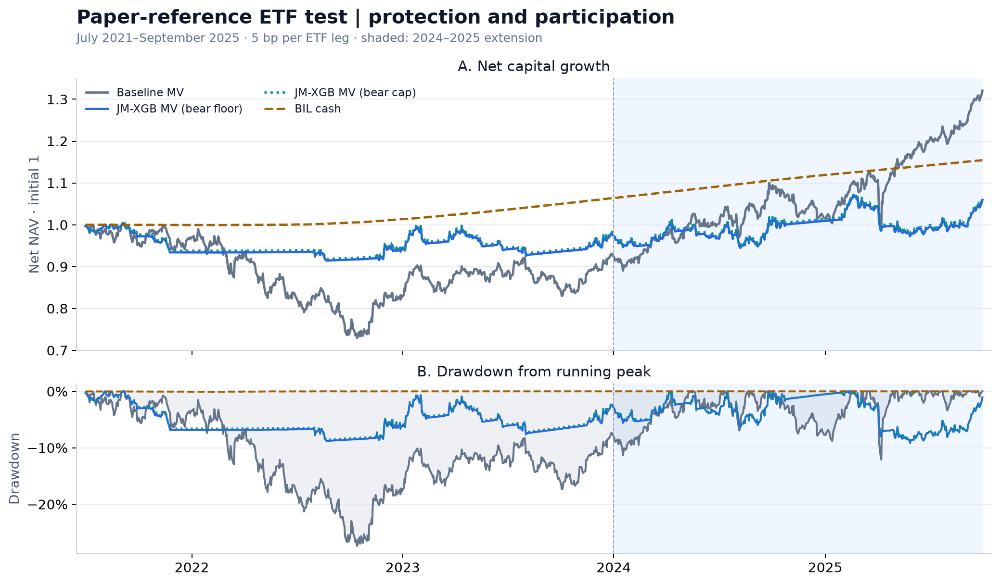
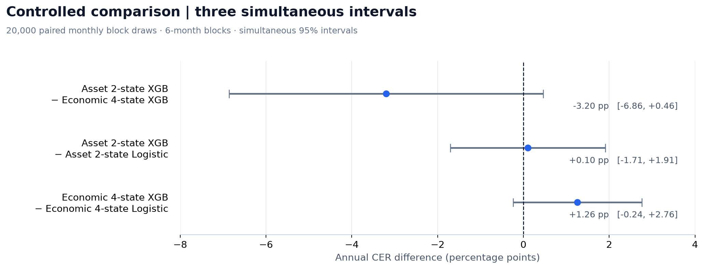

# 자산별 국면 예측을 활용한 글로벌 ETF 자산배분

**논문의 배분 개선 효과를 실제 ETF로 검증하고, 국면 정의와 ML의 추가 가치를 분리한 실증 연구**

[논문](https://arxiv.org/html/2406.09578v2) · [상세 결과](docs/results.md) · [원문과의 조건 대응](docs/paper-comparison.md) · [데이터 명세](#데이터-명세) · [검증 방법론](#검증-방법론) · [재현 안내](docs/reproduction.md)

| 평가 대상 | 표본 밖 평가 | 학습 / 검증 | 독립 검증 규모 |
|---|---|---|---|
| 위험 ETF 8개<br>+ 현금 BIL | 2021.07–2025.09<br>**51개월** | 학습 11년 · 검증 5년<br>6개월마다 갱신 | 59건 독립 재학습<br>120개 계정 재생 |

> **핵심 결과:** 이번 표본에서 원문형 전략은 최대낙폭을 줄였으나 샤프 개선 방향은 유지되지 않았다. 공통 조건으로 수행한 세 주요 CER 비교도 모두 통계적 우위 미확인이다.

## 연구 질문과 설계

- **논문 실증:** Shu·Yu·Mulvey의 자산별 강세·약세 예측이 실제 ETF의 위험조정 성과도 개선하는가?
- **통제 비교:** 배분 조건을 같게 두면 자산별 2국면과 경제 4국면 중 무엇이 유용하며, XGBoost가 로지스틱보다 추가 가치를 주는가?
- 위험자산은 SPY·EFA·EEM·IEF·TLT·LQD·IYR·GLD, 현금은 BIL이다. 상장 전 수익을 합성하지 않았다.
- 미국 종가 후 판단 → 다음 거래일 조정 시가 체결 → 종가 평가. 편도 **5bp**를 BIL 포함 모든 ETF 매매에 부과했다.


원문형 실증은 저자 Jump Model 구현, 11년 학습, 직전 5년 순차 검증, 반년 갱신, 자산별 벌점·초기 평활 선택을 따른다. 원문과 다른 자산·기간·미확정 규칙은 [대응표](docs/paper-comparison.md)에 명시했다.

## 1. 원문에서 보고된 개선이 ETF에서도 유지됐는가?

기본 전략 → JM-XGB 결합 전략의 변화다. 원문은 12개 지수·2007–2023년, 이번 실증은 8개 ETF·2021–2025년이다. ETF 샤프는 일별 BIL 초과수익, 원문은 금리 대용 현금 기준이다. ETF 최대낙폭은 비용 차감 NAV에서 계산했으며 두 표본의 차이를 직접적인 유의성 검정으로 해석하지 않는다.

| 배분 방식 | 원문 샤프 | ETF 샤프 | ETF 최대낙폭 |
|---|---:|---:|---:|
| 평균분산 · 약세 −10bp 하한 | 0.37 → 1.02 | **0.30 → -0.25** | -27.40% → -9.15% |
| 평균분산 · 약세 −10bp 상한 | 0.37 → 1.02 | **0.30 → -0.24** | -27.40% → -9.15% |
| 최소분산 | 0.70 → 1.12 | **-0.05 → -0.15** | -21.43% → -6.32% |
| 동일가중 | 0.51 → 0.91 | **0.13 → -0.19** | -24.23% → -8.85% |

약세 예상수익 −10bp 제한은 원문의 적용 방향이 미확정이라 하한·상한 해석을 모두 공개했다. 유리한 해석을 골라 결과로 제시하지 않았다.



*평균분산 전략의 실제 계정 경로. BIL을 함께 표시해 현금 대비 성과를 구분했다. 음영은 원문 표본 이후인 2024–2025년 확장 구간이다.*

### 결과를 읽는 근거

낙폭 완화와 함께 위험 노출·상승 참여·거래비용도 달라졌다. 아래는 같은 A 실증의 관찰값이며 단독 원인의 효과로 단정하지 않는다.

| 관찰 지표 | 기본 평균분산 | JM-XGB 평균분산 · 하한 해석 |
|---|---:|---:|
| 실제 종가 평균 위험노출 | 100.0% | 47.5% |
| 연 위험 ETF 다리 회전율 | 1.86 | 22.11 |
| 연 비용 / 일별 NAV 합 | 0.10% | 1.72% |

- 현금 대피 규칙은 A 예측일의 **49.1%**에 발동했다. 12개 지수와 8개 ETF에서 같은 강세 자산 수 문턱은 다른 상대적 엄격도를 갖는다.
- 원문 중첩 **30개월**과 이후 확장 **21개월**을 나눠 보고했다. 2024–2025년 상승 구간의 참여 차이도 전체 성과에 영향을 줄 수 있다.
- [기간별 비교](results/study/paper_comparison.csv) · [노출·비용 해석](docs/interpretation.md) · [현금 규칙·평균 추정 연결 실험](results/study/design_bridge.csv)

## 2. 국면 정의와 ML의 추가 가치를 분리하면?

네 조합에 동일한 입력 17개, 월별 학습 가중치, 확률 평활, 축소 평균 추정과 평균분산 배분을 적용했다. 주 지표는 월별 순수익의 **연 CER(위험회피 5)**다.

| 국면 정의 · 분류기 | 연 CER | CAGR | 최대낙폭 | 연 비용/NAV |
|---|---:|---:|---:|---:|
| 자산 2국면 · XGBoost | 1.80% | 2.71% | -13.51% | 0.58% |
| 자산 2국면 · 로지스틱 | 1.69% | 2.65% | -13.21% | 0.57% |
| 경제 4국면 · XGBoost | 5.00% | 5.58% | -8.53% | 0.04% |
| 경제 4국면 · 로지스틱 | 3.74% | 4.25% | -9.27% | 0.04% |

경제 4국면 XGBoost의 CER 점 추정이 가장 높았다. 같은 기간 BIL의 CER는 **3.37%**다. 모형 간 우위는 아래의 쌍체 비교로 판단했다.



*점은 연 CER 차이, 선은 세 비교를 함께 보정한 95% 구간이다. 양수는 왼쪽 모형의 우위를 뜻하며 세 구간 모두 0을 포함한다.*

- 월 쌍체 블록 부트스트랩 **20,000회**, 기본 블록 6개월·민감도 3/12개월, max-T 동시 보정.
- 세 주요 비교 모두 **우위 미확인**이다. 같은 효과라는 결론이나 충분한 검정력을 뜻하지 않는다.
- 입력 제거·경제 6개월 정의·비용 0/10/25bp·현금 규칙·단순 배분을 사전 고정 부록으로 공개했다. [검정·검정력·전체 부록](docs/results.md)

## 데이터 명세

| 자료 | 출처·구성 | 사용 방식·정보시점 |
|---|---|---|
| ETF 가격·기업행사 | Yahoo · 위험 ETF 8개와 BIL의 시가·종가·분배금·분할 | 일별 조정 가격, 분배금 재투자 가정. 상장 전 이력은 채우지 않음 |
| 성장·물가 | ALFRED · 산업생산 INDPRO, 소비자물가 CPIAUCSL | 월별 YoY의 3개월 대 3개월 모멘텀. 첫 공동 완성 빈티지의 라벨·가용일 고정 |
| 시장 입력 | FRED · DGS2, T10Y2Y, VIXCLS 및 ETF 수익으로 계산한 SPY–IEF 상관 | 금리 변화·금리차 수준과 변화·VIX 변화·252거래일 상관의 5개 입력 |
| 초과수익·현금 | FRED DGS3MO / 실제 ETF BIL | DGS3MO는 수익 피처의 기준. 실제 현금 투자·계정 수익은 BIL로 계산 |

- **기간:** 원자료는 2004년부터 가용한 실제 이력만 수집했다. 피처 워밍업·11년 학습·5년 순차 검증을 충족하는 평가 시작일은 **2021-07-01**이다. 2025년 10월 CPI 결측으로 이후 경제 라벨을 연속 구성할 수 없어 **2025-09-30까지 51개월**을 평가했다.
- **가용시점:** 날짜만 있는 FRED·ALFRED 자료는 한 거래일 늦춰 사용한다. 경제 피처는 당시 공개된 빈티지만 사용하며 미래값으로 역채움하지 않는다. FRED 시장자료는 최신 제공 이력에 지연을 적용한 것으로, 과거 수정 이력 전체를 재구성한 자료는 아니다.
- **보존·감사:** 원 응답·다운로드 URL·시각·SHA-256과 기업행사를 보존하고 실제 일별 빈도·NYSE 거래일·결측을 검사했다. [원자료 목록](results/source_manifest.json) · [자료 감사](results/calendar_audit.json) · [상세 데이터 명세](docs/data.md)

## 검증 방법론

### 성과를 비교하는 방법

- **워크포워드 검증(rolling window):** 각 갱신일에 직전 **11년 이동창**으로 재학습하고, 직전 **5년간 당시 모델로 생성해 둔 표본 밖 예측**으로 자산별 Jump 벌점을 선택한다. 다음 **6개월을 일별 예측**한 뒤 학습·검증창을 6개월 앞으로 이동한다. 표준화는 각 학습창에서만 적합하고, Jump Model 평가 라벨은 당시 고정한 모델의 온라인 추론으로 보존한다.
- **공정한 통제 비교:** B의 네 조합은 같은 입력·배분·체결·비용을 사용한다. 월별 라벨 반복이 학습 표본을 부풀리지 않도록 월 가중치 합을 1로 맞추며, 두 자산 2국면 분류기는 같은 선택 라벨을 공유한다.
- **통계 판단:** 월별 순수익의 연 CER(위험회피 5)에 쌍체 원형 블록 부트스트랩 **20,000회**를 적용한다. 기본 블록은 6개월, 민감도는 3·12개월이며 세 주요 비교의 95% 구간을 max-T로 함께 보정한다. 경제 라벨의 일별 반복과 여러 ETF를 독립 표본으로 세지 않는다.
- **검정력·해석:** 연 CER **0.50%p** 고정 효과의 조건부 검정력을 추정한다. 구간이 0을 포함하면 ‘우위 미확인’으로 기록하며, 동등성이나 충분한 검정력을 주장하지 않는다. 재표집은 전체 재학습 불확실성을 포함하지 않는다.

### 정보 누수와 계산을 검증하는 방법

저장된 실제 원자료 검증 결과는 다음과 같다.

| 검사 대상 | 검증 방법 | 결과 |
|---|---|---|
| 미래 정보 | 기준일 이후 가격·시장자료·빈티지·미발표 라벨을 바꿔 이전 피처·튜닝·예측·거래의 불변성 확인 | 통과 |
| 국면·확률 | 고정 JM의 온라인 라벨·클래스 식별, 재학습 경계를 잇는 확률 평활, 확률 합과 학습·가용시점 검사 | 통과 |
| 독립 재학습 | 대표 세 시점에서 캐시를 쓰지 않고 모델을 다시 적합해 저장 예측·라벨과 대조 | **59건 통과** |
| 거래·NAV | 별도 주식 수량 계산으로 전체 경로 재생. 다음 시가 체결·비용·비중 드리프트·자기금융 항등식 확인 | **120개 계정 통과** |
| 최적화 | 실제 해에 대해 전역 목적값 개선의 상한을 독립 계산 | **27개 해 확인** |

- **실행 중단 기준:** 누락 자료·잘못된 빈도·해시 불일치·최적화 실패를 조용히 대체하지 않는다.
- **공개 재현:** CI는 원자료 없이 단위검사와 저장 확률·시점·거래·NAV·해시를 확인한다. 실제 원자료의 독립 재학습·미래 교란·전체 계정 재생은 별도 검증 기록으로 제공한다.
- [전체 방법론](docs/methodology.md) · [실제 원자료 검증 기록](results/study/verification.json) · [실행 기록](results/study/run.json) · [공개 CI](https://github.com/bucheoncityboy/korean-macro-factor-allocation/actions)

**기술:** Python 3.12 · 저자 Jump Model · scikit-learn · XGBoost · CVXPY/OSQP · pandas · GitHub Actions

## 해석의 범위

- 원문은 **12개 지수·2007–2023년 204개월**, 이번 연구는 **8개 실제 ETF·51개월**이다. 금융위기·코로나 급락이 이번 평가에는 없고, BIL·다음 시가 체결 등도 다르다.
- 자산 2국면의 다음 날 상태 예측과 경제 4국면의 관측월 상태 추정은 다른 문제다. 정확도·로그손실을 두 정의 사이에서 직접 비교하지 않는다.
- 이전 결과를 열람한 뒤 재설계한 역사적 순차 분석이며 전향 검증이 아니다. 재표집은 전체 재학습·설계 수정의 불확실성을 포함하지 않는다.

## 재현

아래 CLI는 고정된 자료와 계약을 사용한다. 상세 환경과 실행 소스는 [재현 안내](docs/reproduction.md), 전체 설정은 [프로토콜](configs/protocol.json)에 있다.

```bash
uv sync --frozen --python 3.12
uv run etf-study acquire
uv run etf-study audit
OMP_NUM_THREADS=1 OPENBLAS_NUM_THREADS=1 uv run etf-study run --workers 4
OMP_NUM_THREADS=1 OPENBLAS_NUM_THREADS=1 uv run etf-study verify
uv run etf-study report
uv run etf-study verify --artifacts-only
```

기존 계약을 재현할 때 `audit --freeze`로 덮어쓰지 않는다. 원자료 없는 공개 CI 검증과 실제 원자료 재검증은 별도로 기록한다.
