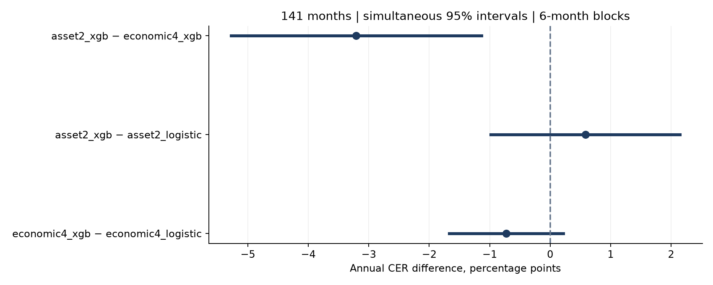

# 국면 예측을 활용한 글로벌 ETF 자산배분

**논문 준거 실증과 141개월 워크포워드 비교로 국면 정의·ML·배분·거래비용의 영향을 검증한 Python 연구**

[원문](https://arxiv.org/html/2406.09578v2) · [전체 후속 결과](docs/followup.md) · [원문과 조건 대응](docs/paper-comparison.md)

| 장기 평가 | 학습·검증 | 거래 | 실제 자료 독립 검증 |
|---|---|---|---|
| 2014.01–2025.09<br>**141개월** | **5년 이동 학습·3년 검증**<br>6개월 갱신 | 일별 판단·다음 시가 체결<br>편도 5bp | **48건** 독립 적합<br>**69개** 계정 재생 |

> **핵심 결과:** 141개월의 자산2 − 경제4 비교는 **경제 4국면 · XGBoost 우위**다. XGBoost − 로지스틱 판정은 자산2 **우위 미확인**, 경제4 **우위 미확인**다.

**목차**

[연구 질문과 설계](#연구-질문과-설계) · [데이터 명세](#데이터-명세) · [검증 방법론](#검증-방법론) · [원문 대비 실증](#원문-대비-실증)<br>
[국면 정의와 ML 비교](#국면-정의와-ml-비교) · [결론](#결론) · [해석의 범위](#해석의-범위) · [재현](#재현)

## 연구 질문과 설계

- **논문 준거 A:** 원문의 자산별 JM–XGBoost 배분 개선이 실제 ETF에서도 유지되는지 11년 학습·5년 검증·51개월 평가로 확인했다.
- **장기 후속 비교:** 같은 ETF의 실제 이력에서 141개월을 확보하도록 학습·검증창을 5년·3년으로 변경했다. 원문 준거 실증과 같은 조건이라고 설명하지 않는다.
- **주요 세 비교:** XGBoost 자산2 − 경제4, 자산2 XGBoost − 로지스틱, 경제4 XGBoost − 로지스틱. 네 조합은 같은 입력·평균 추정·배분·체결·비용을 공유한다.
- **수정 설계 고정:** 얕은 XGBoost, JM 유지·빈도 기준모형, 현금 다리를 포함한 거래 벌점, 21일 계획기간, 2% 소규모 매매 억제를 실행 전에 고정했다. 모든 정책 변형과 24개 원문 연결 실험을 공개한다.
- 이전 결과를 본 뒤 설계한 **역사적 후속 연구**다. 유의성이나 양의 성과를 얻을 때까지 탐색하지 않는다. [고정 프로토콜](configs/followup_protocol.json) · [실행 계약](configs/followup_contract.json)

## 데이터 명세

| 자료 | 출처·구성 | 사용 시점·처리 |
|---|---|---|
| 위험 ETF | Yahoo · SPY·EFA·EEM·IEF·TLT·LQD·IYR·GLD | 실제 상장 이후 일별 시가·종가·분배금·분할 |
| 현금·초과수익 | 실제 BIL / FRED DGS3MO | 실제 계정은 BIL. DGS3MO는 수익 피처·공분산 입력 기준 |
| 경제 국면 | ALFRED INDPRO·CPIAUCSL 빈티지 | 월별 YoY 3개월 대 3개월 모멘텀; 첫 공동 완성 라벨·가용일 보존 |
| 공통 시장 입력 | DGS2 변화, T10Y2Y 수준·변화, VIX 변화, SPY–IEF 252일 상관 | FRED 날짜만 있는 자료는 한 거래일 지연 |

- 원자료는 2004년부터 가용한 실제 이력만 사용한다. 경제자료 최신 수정치의 과거 덮어쓰기·미래값 역채움·상장 전 합성 수익은 금지한다.
- FRED 시장자료는 최신 제공 이력에 지연을 적용한 것으로, ALFRED처럼 모든 과거 수정판을 재구성한 자료는 아니다.
- 평가 종료는 2025년 10월 CPI 결측 이전인 **2025-09-30**이다. 조정 가격은 제공자의 분배금 재투자 가정이며 세금·배당 지급일·실제 슬리피지는 생략한다.
- 원 응답·URL·다운로드 시각·SHA-256·NYSE 달력·기업행사를 검사한다. [141개월 감사](results/followup/audit.json) · [전체 자료 명세](docs/data.md)

## 검증 방법론

- **롤링 워크포워드:** 직전 5년으로 학습하고 직전 3년의 당시 표본 밖 예측으로 Jump 벌점을 선택한다. 다음 6개월을 일별 예측하고 창을 이동한다. 표준화는 학습창에서만 적합한다.
- **모형 통제:** 동일한 입력 17개·월별 학습 가중치·반감기 4일 평활·12개월 상당 평균 축소를 적용한다. XGBoost는 깊이 2·100회·학습률 0.03·L2=5, 로지스틱은 L2·C=1이다.
- **거래 통제:** 종가 후 판단 → 다음 조정 시가 체결 → 종가 평가. 주요 배분은 위험회피 10·상한 40%·공매도/차입 금지·잔여 BIL이다. SPY/IEF 60/40은 별도 기준전략이며 주 비교의 강제 현금 대피는 없다.
- **비용 설계:** 실제 비용은 모든 ETF 다리에서 편도 5bp다. 21일은 최적화의 계획기간으로 거래 벌점만 분산한다. 2% 밴드 안에서는 보유 수량을 유지해 실제 거래·비용이 0이며, 다음 시가를 미리 읽지 않는다.
- **검정:** 월 순수익 연 CER(위험회피 5), 쌍체 원형 블록 20,000회, 기본 6개월·민감도 3/12개월, 세 대비 max-T 동시 95% 구간. ETF 수·월 라벨의 일별 반복을 독립 표본으로 세지 않는다.
- **독립 검증:** 대표 세 경계 48건 재적합, 전체 69개 계정의 별도 주식 수량 재생, 미래 가격·시장·빈티지·미발표 라벨 교란 및 최적화 목적값 상한 검사를 통과했다.
- 누락·잘못된 빈도·해시 불일치·최적화 실패는 중단한다. [검증 기록](results/followup/verification.json) · [검정력·최소 검출 효과](results/followup/power.json)

- 미관측 클래스는 사전확률, 단일 클래스는 빈도 예측으로 처리하고 [발생 횟수](results/followup/fallbacks.json)를 공개한다. 첫 실행의 수치 실패·같은 목적함수의 경계 해 수정도 [별도 기록](docs/followup-design.md#첫-실행-중단과-수치-수정)에 남겼다.

**구현:** Python 3.12 · 저자 Jump Model · scikit-learn · XGBoost · CVXPY/OSQP · pandas · GitHub Actions

## 원문 대비 실증

원문은 12개 지수·2007–2023년, 아래 A는 8개 ETF·2021.07–2025.09의 51개월이다. 11년 학습·5년 검증을 유지한 기준 결과를 보존했다. ETF 샤프는 실제 BIL 초과수익, 원문은 금리 대용 현금 기준이며 두 표본 수치의 차이를 직접 유의성 검정하지 않는다.

| 배분 | 원문 샤프 | 실제 ETF 샤프 | 실제 ETF 최대낙폭 |
|---|---:|---:|---:|
| 평균분산·약세 하한 | 0.37 → 1.02 | 0.30 → -0.25 | -27.40% → -9.15% |
| 평균분산·약세 상한 | 0.37 → 1.02 | 0.30 → -0.24 | -27.40% → -9.15% |
| 최소분산 | 0.70 → 1.12 | -0.05 → -0.15 | -21.43% → -6.32% |
| 동일가중 | 0.51 → 0.91 | 0.13 → -0.19 | -24.23% → -8.85% |

같은 A 예측에서 현금 규칙 2개 × 평균 방식 4개 × 비용 목적함수 3개의 **24개 조합**을 전부 실행했다. 경성/확률 혼합은 같은 조건부 평균·약세 하한을 사용한다. 평균 축소는 현금 기준·월 가중의 묶음 변경으로 표시한다. [전체 분해표](results/followup/factorial.csv)

## 국면 정의와 ML 비교

**141개월 주 결과 · 기본 비용 5bp · 사전 고정한 primary 정책**

| 전략 | 연 CER | CAGR | 샤프 | 최대낙폭 | 평균 위험노출 | 연 비용/NAV |
|---|---:|---:|---:|---:|---:|---:|
| 자산 2국면 · XGBoost | 2.69% | 3.53% | 0.32 | -13.85% | 73.4% | 0.97% |
| 자산 2국면 · 로지스틱 | 2.11% | 3.09% | 0.24 | -15.15% | 75.4% | 1.06% |
| 경제 4국면 · XGBoost | 5.90% | 6.81% | 0.88 | -13.26% | 76.5% | 0.09% |
| 경제 4국면 · 로지스틱 | 6.62% | 7.60% | 0.99 | -13.20% | 78.1% | 0.12% |
| BIL | 1.61% | 1.63% | 0.00 | -0.24% | 0.0% | 0.00% |
| 국면 없는 평균분산 | 4.69% | 5.46% | 0.71 | -13.95% | 74.1% | 0.57% |

**같은 배분 엔진의 기준 예측 · 연 CER**

| 국면 | JM/발표 상태 유지 | 학습 빈도 | 로지스틱 | XGBoost |
|---|---:|---:|---:|---:|
| 자산 2국면 | 2.18% | 5.47% | 2.11% | 2.69% |
| 경제 4국면 | 5.21% | 5.88% | 6.62% | 5.90% |


JM 유지·빈도 예측, 원문 기본 용량 XGBoost, 비용·계획기간·밴드 변형을 모두 공개했다. 좋은 변형을 주 결과로 선택하지 않았다. [모든 기준모형·정책](docs/followup.md)



| 주요 비교 | 연 CER 차이 | 동시 95% 구간 | 판정 |
|---|---:|---:|---|
| 자산 2국면 · XGBoost − 경제 4국면 · XGBoost | -3.21%p | [-5.28, -1.14]%p | 경제 4국면 · XGBoost 우위 |
| 자산 2국면 · XGBoost − 자산 2국면 · 로지스틱 | +0.58%p | [-0.98, +2.15]%p | 우위 미확인 |
| 경제 4국면 · XGBoost − 경제 4국면 · 로지스틱 | -0.73%p | [-1.67, +0.21]%p | 우위 미확인 |

| 비교 | 연 CER 0.50%p 조건부 검정력 | 80% 검정력의 검출 효과 |
|---|---:|---:|
| 자산 2국면 · XGBoost − 경제 4국면 · XGBoost | 3.4% | 2.80%p |
| 자산 2국면 · XGBoost − 자산 2국면 · 로지스틱 | 5.1% | 2.11%p |
| 경제 4국면 · XGBoost − 경제 4국면 · 로지스틱 | 13.3% | 1.27%p |

**배분·거래 수정의 영향 · 같은 예측의 연 CER**

| 고정 정책 | 자산2 XGB | 자산2 로지스틱 | 경제4 XGB | 경제4 로지스틱 |
|---|---:|---:|---:|---:|
| 기존 하루·위험 다리 | 3.74% | 3.22% | 3.84% | 4.12% |
| 현금 다리 포함 | 4.22% | 3.90% | 1.78% | 2.26% |
| 21일 계획기간 | 2.71% | 2.11% | 5.83% | 6.60% |
| 21일 + 2% 밴드 · 주 설정 | 2.69% | 2.11% | 5.90% | 6.62% |
| 21일 + 5% 밴드 · 민감도 | 2.70% | 2.09% | 5.82% | 6.67% |

검정력과 80% 검출 효과는 현재 경로의 의존성·분산에 조건부인 추정치이며 전체 재학습 불확실성이나 미래의 검정력을 보장하지 않는다.

## 결론

- **논문 준거:** 51개월 A에서 낙폭 완화는 관찰됐지만 원문과 같은 샤프 개선 방향은 유지되지 않았다. 이 기준 결과를 후속 실험으로 덮어쓰지 않았다.
- **장기 국면 비교:** 자산 2국면 XGBoost CER **2.69%**, 경제 4국면 XGBoost **5.90%**. 자산2 − 경제4의 기본 검정 판정은 **경제 4국면 · XGBoost 우위**다.
- **ML 추가 가치:** XGBoost − 로지스틱 판정은 자산 2국면 **우위 미확인**, 경제 4국면 **우위 미확인**이다. 우위 미확인은 동등성을 뜻하지 않는다.
- **기준 예측:** 경제4의 빈도 예측 CER는 **5.88%**, 로지스틱은 **6.62%**다. 절대 수익이 났다는 사실을 XGBoost의 추가 가치로 해석하지 않는다.
- **배분 수정의 효과:** 21일 계획기간과 밴드는 모든 모형에서 성과를 개선하지 않았다. 기본 설정을 유지하고 정책별·요인별 결과를 전부 제시했다.
- **남은 판별 한계:** 연 CER 0.50%p 효과의 조건부 검정력은 **3.4%–13.3%**다. 141개월로 확대해도 작은 ML 효과를 충분한 검정력으로 판별한 것은 아니다.

## 해석의 범위

- 후속 설계는 이전 결과 열람 후 고정했다. 완전 미열람·전향 검증, 원문의 수치 재현, 항상 우월한 전략이라고 제시하지 않는다.
- 5년/3년 후속 결과와 11년/5년 원문 준거는 학습·선택 이력이 다르다. 51개월 공통 기간 결과도 별도 공개하며 차이를 한 요인의 인과효과로 해석하지 않는다.
- 경제 관측월 상태 추정과 자산별 다음 날 상태 예측은 다른 문제다. 정확도·로그손실을 두 정의 사이에서 직접 비교하지 않는다.
- 원문의 지수·장기 표본·현금과 실제 ETF·BIL·다음 시가 체결에는 차이가 있다. 모든 민감도 전체에 대한 추가 다중검정 보정이나 전체 재학습 부트스트랩은 포함하지 않는다.

## 재현

```bash
uv sync --frozen --python 3.12
uv run etf-study acquire
OMP_NUM_THREADS=1 OPENBLAS_NUM_THREADS=1 uv run etf-study followup run --workers 4
OMP_NUM_THREADS=1 OPENBLAS_NUM_THREADS=1 uv run etf-study followup verify --workers 4
uv run etf-study followup report
uv run etf-study followup verify --artifacts-only
```

원자료 없이 저장 결과만 검사할 때는 먼저 `uv run python -m etf_regimes.followup_snapshot restore`로 분할 스냅샷을 복원한다. 기존 실행에서는 `followup freeze`로 계약을 덮어쓰지 않는다. [재현 안내](docs/reproduction.md) · [원문 준거 결과](docs/results.md) · [공개 CI](https://github.com/bucheoncityboy/korean-macro-factor-allocation/actions)
