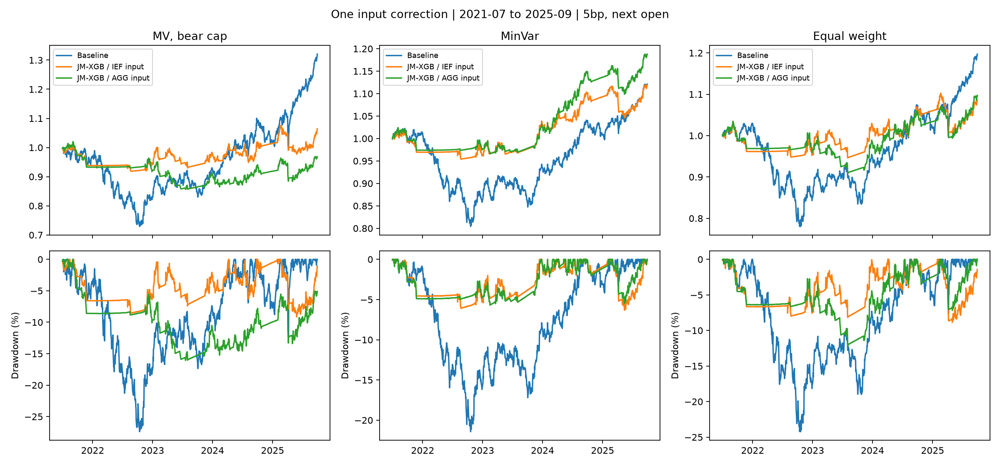
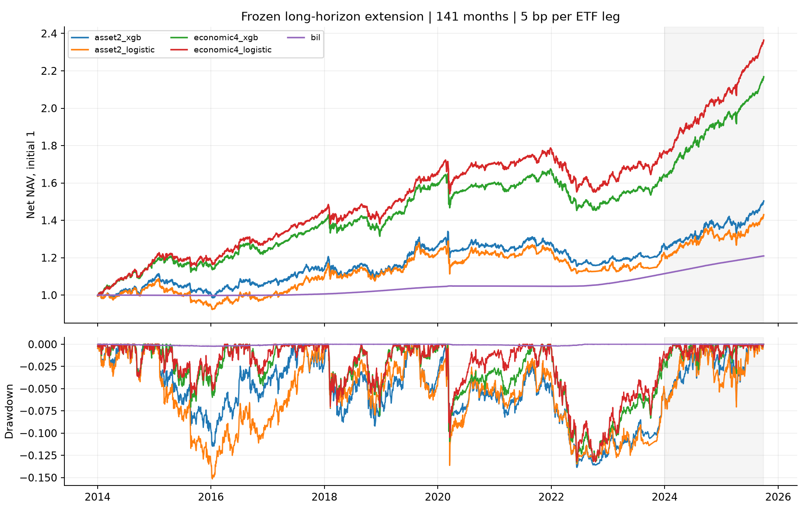

# 국면 예측을 활용한 글로벌 ETF 자산배분

**국면 정의와 머신러닝의 추가 가치를 분리해 검증한 공개 데이터 기반 Python 연구.**

[](https://github.com/bucheoncityboy/korean-macro-factor-allocation/actions/workflows/ci.yml)

`실제 ETF 8개 + BIL` · `일별 판단` · `롤링 워크포워드` · `편도 5bp` · `Python 3.12`

Shu·Yu·Mulvey의 Jump Model–XGBoost 방법을 ETF에 적용하고, **자산별 2국면 vs 경제 4국면**, **XGBoost vs 로지스틱**을 공통 배분 조건에서 비교했다.

> **연구 범위** — 공개 ETF 응용 연구다. 원문의 12개 지수 자료와 전체 실행 패키지는 미확보 상태이며, 동일자료 실증의 재현과 전체 구현의 동등성은 확인하지 못했다. [원문 대응 감사](docs/paper-replication-readiness.md)

[핵심 결과](#핵심-결과) · [논문과의 비교](#논문과의-비교) · [국면과 ML 비교](#국면과-ml-비교) · [실험 설계](#실험-설계) · [데이터 명세](#데이터-명세) · [검증 방법론](#검증-방법론) · [결론](#결론) · [재현](#재현)

## 핵심 결과

- **논문 대비:** 세 배분 모두의 샤프 개선은 유지되지 않았다. 원문에 가까운 **SPY–AGG 상관 입력**으로 수정한 대조에서는 최소분산만 기준 전략보다 높은 샤프를 보였다.
- **국면 정의:** 141개월 주 비교의 연 CER는 경제 4국면 XGBoost **5.90%**, 자산 2국면 XGBoost **2.69%**. 고정된 거래 정책 안에서 경제 4국면 쪽 우위가 확인됐다.
- **ML의 추가 가치:** 두 국면 모두 **XGBoost의 로지스틱 대비 우위는 미확인**이다. 51개월·141개월을 구분하고, 좋은 진단 결과를 주 전략으로 승격하지 않았다.

## 논문과의 비교

**질문:** JM–XGBoost를 넣으면 평균분산·최소분산·동일가중 배분이 함께 개선되는가?

아래는 비용 차감 샤프다. 원문은 **2007–2023년 204개월**, ETF 적용은 **2021.07–2025.09의 51개월**이다. 표본이 달라 개선 방향만 대조하며, 두 표의 차이를 유의성 검정하지 않는다.

| 배분 | 원문 기본 → 국면 | ETF 기본 | 기존 IEF 입력 국면 | 수정 AGG 입력 국면 |
|---|---:|---:|---:|---:|
| 평균분산 · 약세 상한 | 0.37 → 1.02 | 0.298 | −0.237 | −0.598 |
| 최소분산 | 0.70 → 1.12 | −0.046 | −0.147 | **0.177** |
| 동일가중 | 0.51 → 0.91 | 0.135 | −0.188 | −0.155 |

- **입력 수정:** 원문의 주식–종합채권 상관에 맞춰 SPY–IEF를 SPY–AGG로 교체했다. **AGG는 피처 전용**이며 투자 대상·학습·튜닝·배분·비용 조건을 유지했다.
- **수정 후 최소분산:** 최대낙폭 **−21.43% → −5.69%**, 샤프 **−0.046 → 0.177**. 평균분산·동일가중은 낙폭이 줄었지만 샤프는 기준 전략보다 낮았다. 새 통계적 우위 검정은 하지 않았다.
- **해석 범위:** A51은 예측·평균 추정·위험회피·거래벌점·현금 규칙을 함께 바꾼 비교다. XGBoost 단독 효과와 구분한다. 약세 평균의 하한 해석도 별도로 공개한다.



*같은 51개월에서 상관 입력을 바꾼 전후 경로. 기존 결과를 본 뒤 고정한 설명용 대조이며, 원문 동일자료 재현은 아니다.*

[원문 §5·표6](https://arxiv.org/html/2406.09578v2#S5.SS2) · [기존 A51 전체 실증](docs/redesign-paper.md) · [AGG 대조 31개 계정·검증](docs/agg-feature-alignment.md)

<details>
<summary>기존 A51의 개별 ETF 결과 · 8개 모두 보기</summary>

| ETF | B&H 샤프 | JM 유지 샤프 | JM–XGB 샤프 | JM–XGB 최대낙폭 |
|---|---:|---:|---:|---:|
| SPY | 0.56 | 0.18 | 0.78 | −14.82% |
| EFA | 0.29 | −0.20 | −0.44 | −21.98% |
| EEM | −0.01 | −0.35 | 0.07 | −12.09% |
| IEF | −0.57 | −1.03 | −0.44 | −6.19% |
| TLT | −0.60 | −0.81 | −0.86 | −16.06% |
| LQD | −0.40 | −0.83 | −0.68 | −10.96% |
| IYR | −0.00 | −0.30 | 0.01 | −13.20% |
| GLD | 1.04 | 0.18 | 0.28 | −12.07% |

JM 유지는 XGBoost가 선택한 벌점을 공유한다. ETF들을 독립 투자 표본으로 세지 않는다. [전체·기간별 성과](results/redesign/paper_table4.csv) · [예상수익 IC](results/redesign/paper_table7.csv)

</details>

## 국면과 ML 비교

**질문:** 같은 배분을 쓸 때 어떤 국면 정의가 유용하며, XGBoost가 로지스틱보다 나은가?

아래는 **F141 · 2014.01–2025.09 · 주 거래 정책 · 편도 5bp** 결과다. CER는 월 순수익·위험회피 5, 샤프는 일별 BIL 초과수익 기준이다.

| 예측 조합 | 연 CER | CAGR | 샤프 | 최대낙폭 | 연 비용/NAV |
|---|---:|---:|---:|---:|---:|
| 자산 2국면 · 로지스틱 | 2.11% | 3.09% | 0.24 | −15.15% | 1.06% |
| 자산 2국면 · XGBoost | 2.69% | 3.53% | 0.32 | −13.85% | 0.97% |
| 경제 4국면 · 로지스틱 | **6.62%** | 7.60% | 0.99 | −13.20% | 0.12% |
| 경제 4국면 · XGBoost | **5.90%** | 6.81% | 0.88 | −13.26% | 0.09% |



| 주요 비교 | 연 CER 차이 | 동시 95% 구간 | 판정 |
|---|---:|---:|---|
| 자산2 XGB − 경제4 XGB | −3.21%p | [−5.28, −1.14]%p | **경제4 XGB 우위** |
| 자산2 XGB − 자산2 LR | +0.58%p | [−0.98, +2.15]%p | 우위 미확인 |
| 경제4 XGB − 경제4 LR | −0.73%p | [−1.67, +0.21]%p | 우위 미확인 |

- **기준 전략도 확인:** F141 연 CER는 국면 없는 MV **4.69%**, SPY/IEF 60/40 **7.00%**, 자산2 빈도 예측 **5.47%**, 경제4 빈도 예측 **5.88%**. 경제4가 유용하다는 관찰만으로 복잡한 예측기의 필요성이 입증되지는 않는다.
- **입력 범위:** B51/F141은 기존 SPY–IEF 입력을 유지한다. 위 AGG 대조와 섞어 XGBoost의 추가 가치를 주장하지 않는다.

[F141 전체 정책·비교군·검정력](docs/followup.md) · [분류 성능](results/followup/classification.csv)

<details>
<summary>51개월 B51 통제 비교 · 기간과 정책을 구분해서 보기</summary>

| 주요 비교 | 연 CER 차이 | 동시 95% 구간 | 기본 판정 |
|---|---:|---:|---|
| 자산2 XGB − 경제4 XGB | −3.20%p | [−6.86, +0.46]%p | 우위 미확인 |
| 자산2 XGB − 자산2 LR | +0.10%p | [−1.71, +1.91]%p | 우위 미확인 |
| 경제4 XGB − 경제4 LR | +1.26%p | [−0.24, +2.76]%p | 우위 미확인 |

B51은 11년 학습·5년 검증이다. F141은 5년·3년과 정규화 XGBoost·별도 거래 정책을 사용하므로, 두 결과의 차이를 기간 연장만의 효과로 해석하지 않는다. 동시 구간은 각 실험의 세 비교 안에서 보정했다. [B51 전체 결과·민감도](docs/results.md)

</details>

## 실험 설계

| 실험 | 역할 | 학습 / 검증 | 평가기간 |
|---|---|---|---|
| **A51** | 원문 구조에 맞춘 배분 전후 비교 | 11년 / 5년 | 2021.07–2025.09 |
| **B51** | 국면 정의·분류기 통제 비교 | 11년 / 5년 | 2021.07–2025.09 |
| **F141** | 긴 기간·정규화 모형·별도 거래 정책 | 5년 / 3년 | 2014.01–2025.09 |
| **D51** | 조건별 원인 진단 30개 | 고정된 진단별 설정 | 2021.07–2025.09 |
| **AGG 대조** | A51의 상관 입력 하나만 교체 | 11년 / 5년 | 2021.07–2025.09 |

- **국면·예측:** 자산2는 저자 Jump Model, 경제4는 산업생산·CPI 모멘텀의 두 부호다. 다음 거래일 상태를 예측하며, 경제4는 해당 관측월의 라벨을 표적으로 한다. 클래스 수만 다른 동일 문제는 아니다.
- **공정한 비교:** B/F의 두 정의에 수익 8개 + 시장 5개 + 경제 모멘텀 2개 + 관측시차 2개를 공통 제공한다. 월별 학습 가중치 합은 1, 평활 반감기는 4일이다.
- **워크포워드:** 학습창 안에서 표준화하고 과거 순차 검증으로 벌점을 선택한다. 6개월마다 재학습한다. F141의 21일 계획기간·L1 2% 거래보류 기준에도 판단은 일별이다.
- **전체 진단 공개:** 분류기·선택창·평균·현금·공분산·거래 정책의 D51 30개와 입력 제거·경제 6개월·비용 0/10/25bp 등 고정 민감도를 보고한다. [30개 진단](docs/redesign-diagnostics.md) · [설계 명세](docs/redesign-plan.md)

## 데이터 명세

| 구분 | 자료 | 사용 원칙 |
|---|---|---|
| 위험자산 | SPY · EFA · EEM · IEF · TLT · LQD · IYR · GLD | 미국 상장 ETF, 달러 평가, 상장 이후 실제 이력 |
| 현금 | **BIL** | 실제 투자·평가 계정의 현금성 수익 |
| 가격·기업행사 | Yahoo 일별 시가·종가·분배금·분할 | 조정 가격·분배금 재투자 가정, 중복 가산 금지 |
| 경제 | ALFRED **INDPRO · CPIAUCSL** | YoY의 최근 3개월 vs 이전 3개월, 첫 공동 완성 빈티지 보존 |
| 시장 | FRED DGS2 · T10Y2Y · VIXCLS, 주식–채권 상관 | DGS3MO는 일부 피처·원문형 초과수익 추정 기준; 실제 현금 BIL과 구분 |

- **자료 감사:** URL·다운로드 시각·SHA-256·실제 일별 빈도·NYSE 거래일·기업행사를 기록한다. 상장 전 소급·결측 보간 없이 2025년 9월로 평가 종료를 고정했다.
- **가용 시점:** 날짜만 있는 공개자료는 한 거래일 늦춰 사용한다. FRED 시장자료는 최신 제공 이력에 지연을 적용한 자료이며 모든 과거 수정 빈티지를 복원한 것은 아니다.

[전체 데이터 명세·출처](docs/data.md) · [원자료 매니페스트](results/source_manifest.json)

## 검증 방법론

- **정보 시점:** 미래 가격·시장자료·빈티지·미발표 라벨을 바꿔도 이전 피처·튜닝·예측·거래가 유지되는지 검사한다.
- **거래·회계:** 종가 후 판단 → 다음 조정 시가 체결 → 종가 평가. 야간 손익·비중 드리프트·BIL 포함 9개 다리 비용·자기금융 NAV를 같은 엔진에서 검증한다.
- **독립 검증:** 대표 3개 경계의 재적합·선택 재계산·전체 계정 수량 재생을 통과했다. D51은 재적합 **264건**, AGG 대조는 **24건**이다. [D51 실제 자료 검증](results/redesign/verification.json) · [AGG 실제 자료 검증](results/paper_alignment/verification.json)
- **통계:** 월 쌍체 블록 부트스트랩 **20,000회**, 기본 6개월·민감도 3/12개월, 주요 세 비교의 max-T 동시 95% 구간. ETF 수와 일별 반복 경제 라벨을 독립 표본으로 세지 않는다.
- **공개 CI:** 단위검사 **39개**와 원자료 없이 가능한 산출물 복원·검증을 통과했다. 원자료 독립 검증과 공개 CI의 범위를 구분한다. [공개 자료 독립 계산 대조](docs/public-method-reconstruction.md) · [CI](https://github.com/bucheoncityboy/korean-macro-factor-allocation/actions/workflows/ci.yml)

## 결론

- **적용 결과는 표본·배분에 의존했다.** 원문의 세 배분 모두에 걸친 개선은 유지되지 않았고, AGG 대조의 최소분산에서만 개선 방향이 관찰됐다. 자료·기간·현금·체결 및 미확정 구현 차이의 기여를 확정할 수는 없다.
- **국면의 유용성과 ML의 필요성은 별개다.** F141에서는 경제4 XGB가 자산2 XGB보다 높았지만, 두 국면 모두 XGB의 LR 대비 우위는 미확인이다. 분류 점수 개선도 비용 차감 성과 개선을 보장하지 않는다.
- **우위 미확인은 동등성의 증거가 아니다.** F141의 연 CER 0.50%p 효과에 대한 조건부 검정력은 약 3.4%·5.1%·13.3%다. 재표집은 전체 재학습·설계 선택 불확실성을 포함하지 않는다.
- **역사적 연구다.** 이전 결과를 열람한 뒤 설계를 고정했다. 2024년 이후는 원문 표본 이후 확장이지만, 완전히 미열람인 전향 검증은 아니다.

## 재현

```bash
uv sync --frozen --python 3.12
uv run etf-study --help
uv run pytest -q
```

<details>
<summary>저장된 모든 실험 산출물 복원·검증</summary>

```bash
uv run python -m etf_regimes.followup_snapshot restore
uv run python -m etf_regimes.redesign_snapshot restore
uv run python -m etf_regimes.paper_alignment restore
uv run etf-study verify --artifacts-only
uv run etf-study followup verify --artifacts-only
uv run python -m etf_regimes.redesign_snapshot verify
uv run python -m etf_regimes.public_method_checks artifacts
uv run python -m etf_regimes.paper_alignment artifacts
```

</details>

원자료부터 재추정하려면 [A/B 실행](docs/results.md#재현) · [F141 실행](docs/followup-design.md) · [D51 실행](docs/redesign-diagnostics.md#재현과-검증) · [AGG 대조 실행](docs/agg-feature-alignment.md#재현)을 따른다. 기존 계약을 덮어쓰거나 다른 해시의 자료로 조용히 대체하지 않는다.

**구현:** Python 3.12 · 저자 Jump Model(커밋 고정) · scikit-learn · XGBoost 2.1.4 · CVXPY/OSQP · pandas. [잠긴 의존성](uv.lock) · [연구 검수 기록](docs/redesign-review.md)
