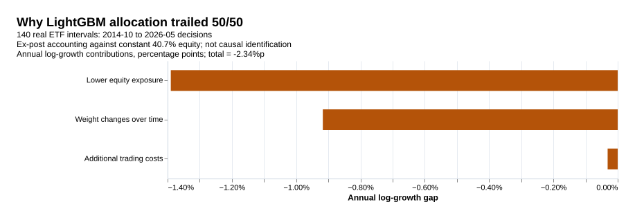

# 성과가 약했던 이유: 실제 자료 진단

- **가장 뚜렷한 병목은 국면을 투자 비중으로 바꾸는 정책이었다.** 미래 국면 정답을 알려줘도 기존 정책의 순 CAGR은 6.58%로, 50/50의 10.17%보다 낮았다. 정답을 이용한 진단은 거래할 수 없으며 성과의 수학적 상한도 아니다.
- **주식 노출과 타이밍이 모두 불리했다.** ML의 평균 주식 비중 40.7%를 고정하면 순 CAGR 8.65%, 실제 ML 비중 변경은 7.63%였다. 연율 로그성장 격차 중 노출 -1.39%p, 타이밍 -0.92%p, 상대 비용 -0.03%p로 분해됐다.
- **기본 국면은 입력 시차보다 빨리 바뀌었다.** 3개월 평활 국면의 평균 지속기간은 2.75개월인데, 알려진 공통 국면에서 예측 표적까지는 4–5개월이었다. 6개월 평활은 지속기간 5.29개월과 함께 빈도 대비 예측 개선을 보였다. 시차만이 원인이라는 인과 증명은 아니다.
- **모형 선택도 불안정했다.** 같은 237개 월에서 고정 λ=1 로지스틱이 내부 24개월로 후보·온도를 고른 절차보다 나았다. LightGBM은 기존 4개 후보를 각각 고정해도 모두 과거 빈도보다 손실이 높았다.

기존 결과를 본 뒤 실시한 **사후 탐색 분석**이다. 기존 주 분석·비교의 유의성 판정·평가월·등록 코드를 바꾸지 않았다. 아래 계산은 [고정한 진단 범위](cause_audit_protocol.md), [실행 설정](../configs/cause_audit.json), [실제 재학습 코드](../src/diagnostics/causes.ts)에서 재현할 수 있다.

## 1. 예측이 실패한 시간 척도

로그손실은 낮을수록 좋다. 기본·평활·수정치·입력 부록을 **같은 201개 판단월**에서 비교했다. LONG_REVISED도 이 표에서는 공통 201개월이며, 전체 298개월 결과와 구분한다. 각 정의는 정답 분포도 다르므로 같은 정의의 과거 빈도와 함께 읽어야 한다.

| 정의·입력 | 평균 지속월 | 빈도 손실 | 전이 손실 | 로지스틱 손실 | LightGBM 손실 |
| --- | --- | --- | --- | --- | --- |
| ARCHIVE (201개월) | 2.75 | 1.3893 | 1.4126 | 1.4216 | 1.4018 |
| SMOOTH_1 (201개월) | 1.31 | 1.3864 | 1.3917 | 1.4029 | 1.3857 |
| SMOOTH_6 (201개월) | 5.29 | 1.4085 | 1.2842 | 1.2021 | 1.2439 |
| REVISED_MATCHED (201개월) | 2.68 | 1.4036 | 1.4088 | 1.4330 | 1.4242 |
| LONG_REVISED (201개월) | 2.68 | 1.4016 | 1.4089 | 1.4199 | 1.4206 |
| DOMESTIC_ONLY (201개월) | 2.75 | 1.3893 | 1.4126 | 1.4062 | 1.4135 |
| EXTERNAL_ONLY (201개월) | 2.75 | 1.3893 | 1.4126 | 1.4047 | 1.3981 |
| EXTRA_EDITION_LAG (200개월) | 2.74 | 1.3892 | 1.4006 | 1.3911 | 1.3922 |

3개월 평활은 201개월에 73개 국면 구간, 6개월 평활은 38개였다. 6개월 로지스틱의 빈도 대비 로그손실 개선은 0.2064 nat, LightGBM은 0.1647 nat였다. 결과를 보고 6개월을 새 주 분석으로 올리지 않는다. 평활을 늘리면 입력·정답·지속성과 겹치는 관측이 함께 변하며, 독립적인 경제 정보가 그만큼 늘어난다는 뜻도 아니다.

**앞선 시차 설명은 수정한다.** 추가 판 지연은 공통 200개월에서 LightGBM 손실을 1.4026→1.3922로 낮췄고, 최신 수정치로 바꿔도 기본 예측을 개선하지 못했다. 따라서 지연·개정만으로 실패를 설명할 수 없다. 타깃 정의와 입력의 시간 척도 부조화가 유력한 설계 문제이며, 원인 하나의 통제 실험은 아니다. OECD 판의 가용일은 가정값으로 실제 국가 발표시각과 동일하지 않다.

## 2. 정답을 알아도 배분은 해결되지 않았다

확대 구간은 **2014-10–2026-05 판단월, 140개 실제 ETF 보유구간**이다. 모든 비교는 같은 일별 체결·분배금·표본과 매수·매도 각각 10bp를 사용한다.

| 배분 | 순 CAGR | 연 순 CER | 평균 목표 주식 비중 |
| --- | --- | --- | --- |
| 정적 50/50 | 10.17% | 6.75% | 50.0% |
| LightGBM 배분 | 7.63% | 5.63% | 40.7% |
| 로지스틱 배분 | 7.60% | 5.57% | 40.8% |
| 국면 전이 배분 | 7.61% | 5.52% | 41.3% |
| 국면 없는 정책 | 6.57% | 5.00% | 35.6% |
| 사후 평균비중 고정 | 8.65% | 6.33% | 40.7% |
| 네 정책 균등 혼합 | 7.68% | 5.55% | 41.7% |
| 미래 정답 선택·거래 불가 | 6.58% | 4.37% | 40.8% |

미래 정답 선택은 매 시점 과거 자료로 추정해 둔 네 정책을 유지하고, 실현된 다음 달 첫 아카이브 국면의 비중을 고른 것이다. 순 CER도 4.37%로 ML의 5.63%, 50/50의 6.75%보다 낮았다. **국면을 잘 맞히는 것만으로 현재 배분 규칙의 성과가 좋아지지 않는다.** 이 결과는 네 국면 자체가 무가치하다거나, 가능한 모든 배분정책이 실패한다는 증명은 아니다.

특히 리세션 정책은 140/140개 판단월 모두 주식 30% 하한이었다. 그런데 아래 실제 보유수익에서 리세션의 주식−국채 차이는 전반부·후반부 모두 양수였다. 여기서 리세션은 산업생산·물가 모멘텀 동반 둔화라는 정의다. 경제 관측월의 이름만으로 그 달의 주식 초과수익 방향을 추정하기 어렵다.

## 3. 성과 격차를 실제 경로에서 분해

| 격차 | 전체 ML−50/50 | 노출 | 비중 변경 타이밍 | 상대 비용 |
| --- | --- | --- | --- | --- |
| 연율 로그성장률 | -2.34%p | -1.39%p | -0.92%p | -0.03%p |
| 연 순 CER | -1.12%p | -0.42%p | -0.67%p | -0.03%p |

비용 0bp에서 평균비중 고정과 50/50의 차이를 노출 항으로, ML과 평균비중 고정의 차이를 타이밍 항으로 계산했다. 마지막에 두 전략의 10bp 비용 차이를 더한다. 합계 항등식은 수치 오차 1e−12 이내에서 성립했다. CAGR 격차 -2.55%p와 연율 로그성장 격차 -2.34%p는 서로 다른 지표다.

노출 항은 로그성장 손실의 59.4%, 타이밍은 39.2%, 상대 비용은 1.3%였다. 이는 사후 평균비중을 사용한 회계 분해다. 위험을 덜 부담한 선택도 수익 차이에 포함되므로 낮은 CAGR만으로 정책 실패를 판정하지 않으며, 같은 분해에서 CER도 낮다는 점을 함께 본다.

## 4. 국면별 수익 추정이 안정적이지 않았다

140개 구간을 시간순 70/70으로 고정해 모두 공개했다. 아래는 월 보유구간의 **주식 수익률−국채 수익률 평균**이며 연율화 값이 아니다. 미래의 국면을 알아도 쓸 수 있는 정책인지는 따로 검증해야 한다.

| 국면 | 전반부 N | 전반부 평균 차이 | 후반부 N | 후반부 평균 차이 |
| --- | --- | --- | --- | --- |
| 골디락스 | 12 | 1.05%p | 15 | 3.90%p |
| 오버히트 | 22 | -0.60%p | 21 | 2.83%p |
| 리세션 | 22 | 1.22%p | 18 | 3.21%p |
| 스태그플레이션 | 14 | 0.19%p | 16 | 0.00%p |

전반부는 2014-10–2020-07, 후반부는 2020-08–2026-05 판단월이다. 오버히트의 평균 차이는 음수에서 양수로 바뀌었다. 리세션은 두 구간 모두 양수지만 당시 알 수 있던 과거 평균·60개월 공분산·위험회피 계수로 만든 정책은 주식을 계속 30%에 묶었다. 배분 시작 시 국면별 학습 표본도 8·16·22·14개뿐이었다.

전체 560개 시점×국면 비중 중 283개가 하한, 85개가 상한에 걸렸다. 네 비중의 평균 최대−최소 간격은 28.27%p였다. 정책이 전부 같은 비중으로 붕괴한 것은 아니지만, 소수 조건부 표본·축소·서로 다른 평균/공분산 이력·비중 제한이 함께 작동했다. 이 항목들의 개별 인과 기여는 이번 분석에서 식별하지 않았다.

## 5. ML·규제·선택·보정 진단

237개 판단시점마다 두 학습모형의 같은 가용 학습 행으로 **8개 후보를 실제 재학습**했다. 선택된 후보의 보정 전 확률은 기존 산출물과 1e−12 이내에서 일치했다. 고정 후보와 앙상블을 전부 표시하며, 사후 최적 후보를 새 승자로 선언하지 않는다.

| 모형 | 고정 후보·T=1 | N | 로그손실 |
| --- | --- | --- | --- |
| 로지스틱 | 0 | 237 | 1.4737 |
| 로지스틱 | 1 | 237 | 1.4010 |
| 로지스틱 | 2 | 237 | 1.3798 |
| 로지스틱 | 3 | 237 | 1.3899 |
| 로지스틱 | EQUAL_ENSEMBLE | 237 | 1.3884 |
| LightGBM | 0 | 237 | 1.3951 |
| LightGBM | 1 | 237 | 1.4163 |
| LightGBM | 2 | 237 | 1.3958 |
| LightGBM | 3 | 237 | 1.4157 |
| LightGBM | EQUAL_ENSEMBLE | 237 | 1.4010 |

로지스틱 후보 0/1/2/3은 λ=0.01/0.1/1/10이다. LightGBM 후보는 각각 3잎·깊이2·40회, 3잎·깊이2·80회, 5잎·깊이3·40회, 5잎·깊이3·80회다. 앙상블은 4개 확률의 동일 가중 평균이다.

고정 λ=1의 손실 1.3798은 선택·보정한 로지스틱 1.4129보다 낮았다. LightGBM의 80회 후보들은 같은 구조의 40회 후보보다 손실이 높았으며, 4개 모두 기존 과거 빈도 1.3930을 넘었다. 24개 내부 검증월에서 4후보×3온도를 선택하는 절차가 불안정하다는 증거와 일치하지만, 선택 오차나 과적합의 인과량을 추정한 것은 아니다.

| 모형 | 선택 후보 보정 전 | 선택·보정 후 | 보정의 손실 개선 |
| --- | --- | --- | --- |
| 국면 전이 | 1.3972 | 1.4071 | -0.0099 |
| 로지스틱 | 1.4411 | 1.4129 | 0.0282 |
| LightGBM | 1.4072 | 1.3991 | 0.0082 |

확률 보정은 확대 기본 구간의 로지스틱·LightGBM 손실을 개선했다. 보정이 전체 실패의 주원인이라는 설명은 맞지 않는다. 반면 6개월 평활에서는 두 모형 모두 보정 후 손실이 높아졌다. [8개 시나리오별 전·후](../results/four-regime/cause-audit/calibration.csv)를 함께 공개한다.

## 6. 비교군 이력 차이로 결과가 뒤집히는가

기존 기준모형은 두 학습모형보다 과거 라벨 94개를 더 사용했다. 첫 비교 시 학습모형 87행 대 기준 181개, 마지막은 323행 대 417개다. 로지스틱과 LightGBM끼리는 처음부터 같은 학습 행이었다.

| 같은 학습 표적월만 사용한 기준 | N | 로그손실 |
| --- | --- | --- |
| UNIFORM | 237 | 1.3863 |
| FREQ_MATCHED_HISTORY | 237 | 1.3917 |
| MARKOV_MATCHED_HISTORY_RAW | 237 | 1.3990 |
| MARKOV_MATCHED_HISTORY | 237 | 1.4059 |

과거 빈도는 이력을 맞춰도 1.3917로, 기존 ML 1.3991·로지스틱 1.4129보다 낮았다. 균등 25% 확률도 1.3863이었다. 이력 차이는 명시할 공정성 문제지만 성과 부진 전체를 설명하지 않는다.

## 7. 예측이 개선된 6개월 평활도 배분 병목이 남았다

기존 부록의 **2016-11–2026-05, 115구간**을 그대로 재생했다. 확대 140구간과 직접 수익률을 비교하지 않는다.

| 배분 | 순 CAGR | 연 순 CER | 평균 목표 주식 비중 |
| --- | --- | --- | --- |
| 정적 50/50 | 11.92% | 7.80% | 50.0% |
| LightGBM 배분 | 8.50% | 6.39% | 36.4% |
| 로지스틱 배분 | 8.26% | 6.05% | 37.1% |
| 국면 전이 배분 | 8.70% | 6.50% | 36.8% |
| 국면 없는 정책 | 7.51% | 5.63% | 36.9% |
| 사후 평균비중 고정 | 9.18% | 6.92% | 36.4% |
| 네 정책 균등 혼합 | 8.24% | 6.09% | 37.2% |
| 미래 정답 선택·거래 불가 | 9.30% | 6.24% | 38.4% |

미래 정답 선택의 CAGR은 9.30%로 같은 구간 50/50의 11.92%보다 낮았다. 더 예측하기 쉬운 정답을 만드는 것과 수익을 잘 배분하는 것은 별도 문제다.

## 8. 연도별 기여와 다음 설계의 우선순위

아래 값은 각 판단연도에 속한 보유구간의 ML−50/50 **누적 로그수익 차이**다. 2014년은 3구간, 2026년은 5구간이며 완전한 달력연도 수익률이 아니다.

| 판단연도 | 구간 수 | 누적 로그수익 차이 | 평균 ML 주식 비중 |
| --- | --- | --- | --- |
| 2014 | 3 | -0.12%p | 40.7% |
| 2015 | 12 | 0.66%p | 38.6% |
| 2016 | 12 | -0.96%p | 42.4% |
| 2017 | 12 | 0.65%p | 54.0% |
| 2018 | 12 | -2.02%p | 58.3% |
| 2019 | 12 | 0.10%p | 47.7% |
| 2020 | 12 | -7.79%p | 35.5% |
| 2021 | 12 | 1.38%p | 37.6% |
| 2022 | 12 | 1.54%p | 33.7% |
| 2023 | 12 | -0.65%p | 33.4% |
| 2024 | 12 | 0.84%p | 33.6% |
| 2025 | 12 | -11.23%p | 35.6% |
| 2026 | 5 | -9.66%p | 34.3% |

- **먼저 배분정책의 경제적 타당성을 확인한다.** 국면 정답을 알아도 효용이 개선되지 않는 정책에 예측 모델만 더 붙이지 않는다. 상태별 수익의 안정성과 노출을 맞춘 기준을 별도 평가해야 한다.
- **국면의 시간 척도를 다시 설계한다.** 현재 3개월 라벨의 짧은 지속성과 4–5개월 정보 간격을 함께 고려한다. 6개월 결과는 다음 설계의 근거이며 검증 완료한 새 전략은 아니다.
- **선택 자유도를 줄인 기준을 포함한다.** 강한 규제 로지스틱·고정 후보·균등 확률·동일 이력 기준과 ML을 비교한다. 현재 표본의 최고 후보를 새 성과로 포장하지 않는다.
- **최종 판정은 미열람 자료에서 한다.** 지금의 실험은 원인 후보와 기존 경로의 분해다. 새 정의·정책·모형 조합의 검증력을 이 결과로 확정할 수 없다.

전체 경로·4후보 확률·정책·해시·검증 코드는 [원인 진단 산출물](../results/four-regime/cause-audit/), [실행 명세](../results/four-regime/cause-audit/manifest.json), [재현 명령](reproduction.md)에 있다. 합성 실증 자료나 새 확인적 유의성 검정은 사용하지 않았다.
