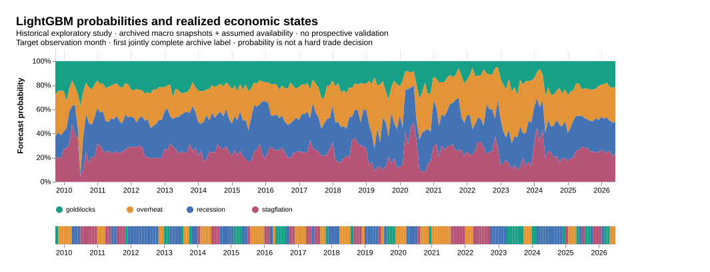
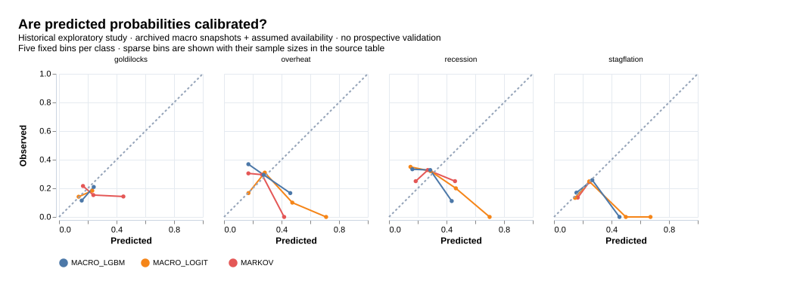
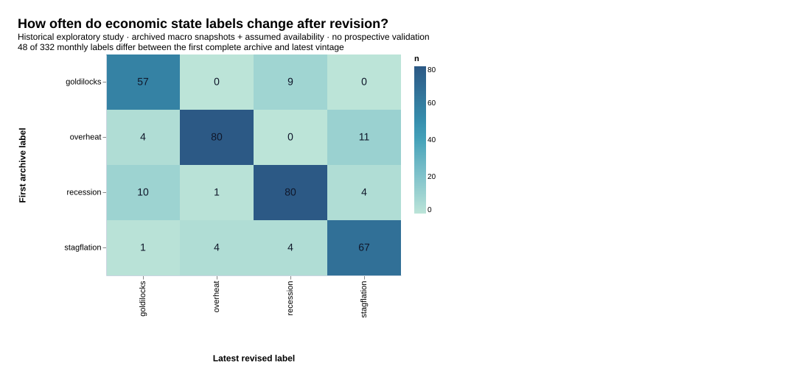
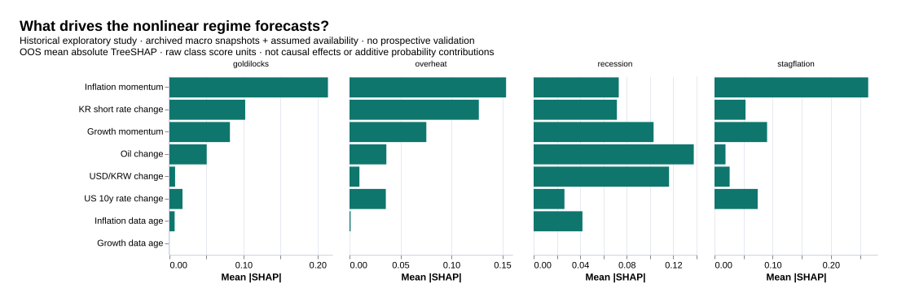
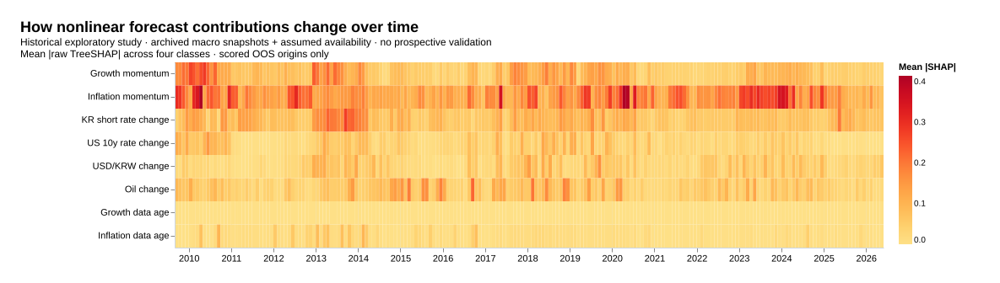

# 한국 4국면 예측·ML·자산배분 실증 보고서

- 연구 ID: `kr-four-regime-20261018-v1`. 결과 생성일 2026-10-17T20:35:57.676Z. 실행 소스 `e98e111ab3773a14e757448803fe0aba496b4cf6`.
- 주 분석: 2009-09–2026-05 예측 201개월, 2016-11–2026-05 배분 115개월. 보조 장기 수정치 예측 2001-10–2026-07 298개월.
- 기존 ETF 수익을 이미 관찰한 역사 탐색 연구다. 해시 등록과 실행 순서를 보존했지만 독립 전향 확인연구는 아니다.

## 1. 주 결론과 연구 기여

LightGBM 대 국면 전이: **국면 예측과 배분 효용의 추가 가치를 확인하지 못했다.** LightGBM 대 로지스틱: **국면 예측과 배분 효용의 추가 가치를 확인하지 못했다.**

| 비교: 앞 모형−뒤 모형 | 로그손실 개선 [동시 95% 구간] | 연 순 CER 개선 [동시 95% 구간] |
| --- | --- | --- |
| 로지스틱 - 국면 전이 | -0.009 [-0.086, 0.060] | 0.01%p [-0.38%p, 0.37%p] |
| LightGBM - 국면 전이 | 0.011 [-0.062, 0.074] | 0.15%p [-0.32%p, 0.71%p] |
| LightGBM - 로지스틱 | 0.020 [-0.034, 0.076] | 0.14%p [-0.24%p, 0.57%p] |

기여는 새로운 4분면이나 새로운 ML 알고리즘의 발명이 아니다. 한국 자료에서 라벨의 발표·개정, 예측확률의 평가, 같은 배분정책을 공유하는 모형 비교를 연결하고 그 한계를 재현 가능하게 공개한 것이다. 양의 점추정·통계적 구간·실무적 최소효과(0.02 nat, 연 CER 0.50%p)를 구별한다.

## 2. 자료·정의·시간축

[실행 계약](four_regime_preregistration.md)과 [데이터 사전](four_regime_data.md)에 수식·가용성 가정을 기록했다. 성장 축은 산업생산 YoY, 물가 축은 CPI YoY의 3개월 대 3개월 평균 변화다. 국면은 네 조합으로 고정했다. 월말 판단에서 다음 관측월까지 예측하며, 그 시점에 알 수 있는 가장 최근 국면은 몇 달 전일 수 있다.

[원자료 감사](../results/four-regime/data-audit.json)는 별도 공식 CPI flow의 441개월 비교와 산업생산 YoY의 428개월 비교를 포함한다. 주식·채권 ETF 이력은 공동 2009-07-29부터 2026-10-16까지 4,240 세션이며 상장 전으로 소급하지 않았다. 주 점수는 사전 고정한 2026-05까지 가용한 라벨만 사용한다. 추가 지연 부록의 말단 표본 차이 D1은 6절에 별도로 설명한다. 2026-06 이후의 예측 파일은 주 평가에 포함되지 않는다.

**결과 후 수행한 구성 타당성 진단:** [IMF/FRED 실질 GDP](https://fred.stlouisfed.org/series/NGDPRSAXDCKRQ)의 최신 수정치와 67개 분기(2009-Q4–2026-Q2)를 대조했다. 산업생산 모멘텀의 분기 평균과 GDP YoY의 직전 분기 대비 변화의 상관은 **0.526**, 방향 일치는 <strong>56.7%</strong>였다. GDP가 전분기 대비 감소한 8개 분기 안에서 월간 리세션 라벨의 평균 비중은 45.8%, 나머지 59개 분기에서는 29.9%였다. [분기별 대조](../results/four-regime/construct-validity-quarterly.csv)와 [취득 해시·한계](../results/four-regime/construct-validity.json)를 공개한다.

이 관계는 산업생산을 경제 전체의 완전한 대리변수로 검증한 결과가 아니다. 월간 라벨을 GDP 음의 성장이나 공식 경기순환 연대기와 동일시하지 않는다. 분기 GDP를 세 달에 배정해 독립 GDP 관측 수를 부풀리지 않았고, 이 진단으로 국면 경계·피처·주 표본을 바꾸거나 신규 유의성 검정을 추가하지 않았다. GDP는 예측 입력이 아니다.

## 3. 주 예측·확률 보정·국면별 성과

| 방법 | 로그손실 ↓ | Brier ↓ | 균형 정확도 ↑ | Macro F1 ↑ |
| --- | --- | --- | --- | --- |
| 과거 빈도 | 1.389 | 0.751 | 20.0% | 0.138 |
| 마지막 국면 지속 | 3.535 | 1.472 | 22.5% | 0.225 |
| 국면 전이 | 1.413 | 0.766 | 22.3% | 0.223 |
| 로지스틱 | 1.422 | 0.771 | 16.2% | 0.132 |
| LightGBM | 1.402 | 0.760 | 21.2% | 0.200 |

미보정 확률과 보정 확률을 구분한다.

| 모형 | 미보정 로그손실 | 내부 보정 로그손실 |
| --- | --- | --- |
| 과거 빈도 | 1.389 | 1.389 |
| 마지막 국면 지속 | 3.535 | 3.535 |
| 국면 전이 | 1.400 | 1.413 |
| 로지스틱 | 1.452 | 1.422 |
| LightGBM | 1.410 | 1.402 |

[클래스별 precision/recall/F1](../results/four-regime/class-metrics.csv), [혼동행렬](../results/four-regime/confusion.csv), [보정 빈별 표본 수](../results/four-regime/calibration.csv), [전체 튜닝 추적](../results/four-regime/tuning-trace.csv)을 제공한다. 보정은 학습 내부에서 선택했으며 결과를 보고 재보정하지 않았다.

[후보·온도의 선택 빈도](../results/four-regime/model-selection-counts.csv)를 주 평가 201개월에서 집계했다. 전체 실행의 진행 시각은 원장에 보존했지만 후보별 전체 소요시간은 계측하지 않았다. 학습 효율의 우열을 이 실행에서 검증했다고 주장하지 않는다.

## 4. 국면 에피소드와 전환

| 국면 | 관측월 | 에피소드 | 평균 지속 개월 |
| --- | --- | --- | --- |
| 골디락스 | 33 | 17 | 1.94 |
| 오버히트 | 59 | 19 | 3.11 |
| 리세션 | 64 | 19 | 3.37 |
| 스태그플레이션 | 45 | 18 | 2.50 |

월별 행 수를 독립적인 전환 사건 수로 바꾸지 않는다. 평활 때문에 이웃 라벨이 의존한다.

**결과를 본 뒤 추가한 기술 진단:** 가장 최근 가용 국면에서 타깃까지 4–5개월이 필요했다. 양 끝의 불완전 에피소드를 제외한 71개 중 51개는 첫 완성 라벨이 가정상 가용해질 때 이미 종료돼 있었다. [월별·에피소드별 계산](../results/four-regime/timing-diagnostic.json)을 공개한다. 주 가설·기간·모형을 바꾸는 근거로 쓰지 않았다. OECD 판의 지연 가정이 국내 실제 최초 공표보다 늦을 수 있으므로 이 수치를 한국 통계의 실제 공표 지연으로 해석하지 않는다.

| 모형 | 실제 전환 | 새 에피소드 내 탐지 | 예측 변화 | 오경보 |
| --- | --- | --- | --- | --- |
| 과거 빈도 | 72 | 18 | 5 | 5 |
| 마지막 국면 지속 | 72 | 24 | 68 | 45 |
| 국면 전이 | 72 | 25 | 69 | 44 |
| 로지스틱 | 72 | 22 | 59 | 38 |
| LightGBM | 72 | 30 | 95 | 56 |

[모든 전환의 지연/미탐지](../results/four-regime/transition-events.csv)를 남겼다. 오경보는 실제 국면이 그대로인데 argmax 예측이 바뀐 달이다. 지연은 새 실제 에피소드 안에서 처음 정답이 나온 시점이며 끝내 정답이 없으면 null이다. 정의가 다른 실시간 이벤트 탐지 성능으로 일반화하지 않는다.

## 5. 배분·노출·비용

| 전략 | 순 CAGR | 연 순 CER | 일별 MDD | 평균 주식 비중 |
| --- | --- | --- | --- | --- |
| 50/50 정적 | 11.92% | 7.80% | -20.47% | 50.0% |
| 국면 없는 정책 | 7.51% | 5.63% | -15.21% | 36.9% |
| 국면 전이 배분 | 8.78% | 6.28% | -19.07% | 41.6% |
| 로지스틱 배분 | 8.72% | 6.29% | -18.80% | 40.9% |
| LightGBM 배분 | 8.82% | 6.43% | -16.39% | 40.9% |
| 수익률 Ridge | 13.59% | 8.02% | -20.99% | 51.7% |

국면별 평균은 `n/(n+24)`로 전체 평균에 수축한다. 최근 완성 60개월 공분산의 비대각 항에 0.9를 곱하고 gamma=5의 평균-분산 목적함수를 최대화한다. 최종 비중은 네 정책의 확률 가중합이다. 세 예측모형에 매월 같은 네 비중을 적용했고 실제 산출물에서 그 등식을 검증했다.

| 전략 | SAA 하락월 N | 해당 월 평균 순수익 |
| --- | --- | --- |
| 50/50 정적 | 44 | -2.20% |
| 국면 없는 정책 | 44 | -1.70% |
| 국면 전이 배분 | 44 | -1.91% |
| 로지스틱 배분 | 44 | -1.88% |
| LightGBM 배분 | 44 | -1.85% |
| 수익률 Ridge | 44 | -2.28% |

RETURN_TAA는 완료된 수익의 지연값·3개월 평균·12개월 변동성으로 Ridge를 학습하는 외부 전략 비교다. 정책이 달라 거시정보만의 인과적 증분 효과로 해석하지 않는다. SAA 하락월의 평균 수익·목표/드리프트 노출·회전율·총비용은 [월별 손익](../results/four-regime/ARCHIVE/allocation-monthly.csv)과 [요약](../results/four-regime/ARCHIVE/allocation-summary.csv)으로 확인할 수 있다.

RETURN_TAA의 규제 후보는 0.01·0.1·1·10, 내부 검증은 과거 12개 origin이다. 이전 연구의 달력 월말 수익이 아닌 이번 체결 간 완료 수익으로 구성해, 이전 전략을 그대로 복사한 독립 성과로 부르지 않는다.

[사후 국면별 자산 분포](../results/four-regime/state-asset-distribution.csv)는 6개월 블록 재표집의 점별 95% 구간을 포함한다. 미래의 정답 국면을 알고 투자할 수 있다는 뜻이 아니다. 두 ETF가 함께 하락하는 상황까지 완전히 방어하는 자산 구성이 아니다.

[국면별 주식·채권 상관](../results/four-regime/state-asset-correlation.csv)은 같은 115개 체결 구간을 정답 국면으로 사후 분류한 기술 통계다. 정책에 네 개의 별도 공분산을 넣거나 이 상관을 미래에 알려진 값으로 사용하지 않았다.

## 6. 장기 표본·빈티지·입력 제거·평활 민감도

| 실험 | 모형 | 평가 N | 로그손실 |
| --- | --- | --- | --- |
| REVISED_MATCHED | 국면 전이 | 201 | 1.409 |
| REVISED_MATCHED | 로지스틱 | 201 | 1.433 |
| REVISED_MATCHED | LightGBM | 201 | 1.424 |
| LONG_REVISED | 국면 전이 | 298 | 1.414 |
| LONG_REVISED | 로지스틱 | 298 | 1.425 |
| LONG_REVISED | LightGBM | 298 | 1.417 |
| SMOOTH_1 | 국면 전이 | 201 | 1.392 |
| SMOOTH_1 | 로지스틱 | 201 | 1.403 |
| SMOOTH_1 | LightGBM | 201 | 1.386 |
| SMOOTH_6 | 국면 전이 | 201 | 1.284 |
| SMOOTH_6 | 로지스틱 | 201 | 1.202 |
| SMOOTH_6 | LightGBM | 201 | 1.244 |
| DOMESTIC_ONLY | 국면 전이 | 201 | 1.413 |
| DOMESTIC_ONLY | 로지스틱 | 201 | 1.406 |
| DOMESTIC_ONLY | LightGBM | 201 | 1.413 |
| EXTERNAL_ONLY | 국면 전이 | 201 | 1.413 |
| EXTERNAL_ONLY | 로지스틱 | 201 | 1.405 |
| EXTERNAL_ONLY | LightGBM | 201 | 1.398 |
| EXTRA_EDITION_LAG | 국면 전이 | 200 | 1.401 |
| EXTRA_EDITION_LAG | 로지스틱 | 200 | 1.391 |
| EXTRA_EDITION_LAG | LightGBM | 200 | 1.392 |

ARCHIVE의 201개 주 표본과 LONG_REVISED의 298개 장기 표본은 다른 실험이다. 장기 표본의 성과를 아카이브 성과로 바꿔 제시하지 않는다. REVISED_MATCHED는 역사적으로 있었던 관측월의 마스크·라벨 가용일을 유지하면서 최신 값과 최신 라벨을 사용한다. [최신치 모형을 첫 라벨로 채점](../results/four-regime/matched-latest-scored-on-first-label.csv)과 [아카이브 모형을 최신 라벨로 채점](../results/four-regime/archive-scored-on-latest-label.csv)도 남겨 타깃 정의의 차이를 분리해 살핀다.

첫 공동 완성 아카이브 대비 최신치의 라벨은 <strong>48/332개월(14.5%)</strong>에서 다르다. 이 빈도는 자료의 개정과 아카이브 반올림/방법 변경의 영향을 함께 포함하며, 국가 최초 발표의 오류율이 아니다.

SMOOTH_1/6은 각 평활 정의에서 라벨과 정책을 다시 만든 결과다. DOMESTIC_ONLY는 성장·물가·국내 단기금리와 관측월 나이, EXTERNAL_ONLY는 미국금리·환율·원유와 같은 나이 통제를 사용한다. EXTRA_EDITION_LAG는 입력과 학습/정책 라벨을 모두 한 판 늦춘다. 다섯 아카이브 민감도는 201개 예측월을 공유한다. **추가 지연은 미공개 말단 라벨 때문에 200개**이며 [같은 200개 월의 기본안과 짝지은 비교](../results/four-regime/extra-lag-common-forecast.json)를 별도로 제공한다. 투자 수익은 모든 아카이브 민감도에서 같은 115개 체결 구간이 완성돼 있다.

**프로토콜 차이 D1:** 처음에는 한 판 추가 지연도 2026-05까지 라벨이 완성될 것으로 잘못 잡았다. 독립 검증이 201개 공통 마스크 가정을 거부했다. 2026-08 생산 아카이브가 2026-05까지만 포함해 2026-06 라벨은 2026-09 판에서 처음 완성된다. 이를 한 판 더 늦추면 2026-11-01에 가용하므로 study_asof 이후다. 코드가 해당 미공개 라벨을 이미 제외했으며, 주 6개 비교는 바꾸지 않았다. [원래 검증 실패](../results/four-regime/verification-initial-failure.txt)와 [편차 기록](../results/four-regime/protocol-deviations.json)을 보존했다. 이 차이를 숨기거나 유리한 달로 대체하지 않았다.

| 민감도 | 전략 | 연 순 CER | 순 CAGR |
| --- | --- | --- | --- |
| cost_0bp | 국면 전이 배분 | 6.33% | 8.83% |
| cost_0bp | 로지스틱 배분 | 6.33% | 8.77% |
| cost_0bp | LightGBM 배분 | 6.49% | 8.89% |
| cost_5bp | 국면 전이 배분 | 6.31% | 8.81% |
| cost_5bp | 로지스틱 배분 | 6.31% | 8.75% |
| cost_5bp | LightGBM 배분 | 6.46% | 8.86% |
| cost_25bp | 국면 전이 배분 | 6.21% | 8.70% |
| cost_25bp | 로지스틱 배분 | 6.22% | 8.65% |
| cost_25bp | LightGBM 배분 | 6.34% | 8.72% |
| gamma_2 | 국면 전이 배분 | 6.28% | 8.78% |
| gamma_2 | 로지스틱 배분 | 6.29% | 8.72% |
| gamma_2 | LightGBM 배분 | 6.43% | 8.82% |
| gamma_10 | 국면 전이 배분 | 6.28% | 8.78% |
| gamma_10 | 로지스틱 배분 | 6.29% | 8.72% |
| gamma_10 | LightGBM 배분 | 6.43% | 8.82% |
| shrink_12 | 국면 전이 배분 | 6.28% | 8.78% |
| shrink_12 | 로지스틱 배분 | 6.29% | 8.72% |
| shrink_12 | LightGBM 배분 | 6.43% | 8.82% |
| shrink_48 | 국면 전이 배분 | 6.28% | 8.78% |
| shrink_48 | 로지스틱 배분 | 6.29% | 8.72% |
| shrink_48 | LightGBM 배분 | 6.43% | 8.82% |

정책 gamma를 바꾼 민감도에도 평가 CER의 gamma는 5다. [3/12개월 블록 추론](../results/four-regime/bootstrap-block-sensitivity.csv), [시기별 성과](../results/four-regime/subperiods.csv), [민감도 실패 원장](../results/four-regime/sensitivity-failures.json)을 전부 공개했다. 민감도에서 가장 좋은 설정을 골라 주 결과로 바꾸지 않는다.

## 7. ML 해석·실패 사례

[국내·대외·정보나이 그룹](../results/four-regime/shap-groups.csv), [연도·국면·피처별 기여](../results/four-regime/shap-annual.csv)를 제공한다. 그룹 기여의 절댓값 평균과 피처별 절댓값의 합을 따로 저장해 상쇄를 숨기지 않는다.
클래스별 SHAP와 expected value의 합은 해당 클래스 raw score와 일치해야 한다. 모든 OOS 행에서 이 조건을 검사했다. 온도 T로 나눈 점수에 softmax를 적용해 네 확률을 만든다. 이 기여도를 확률의 가산 분해나 인과적 효과라고 해석하지 않는다.

[확신이 컸던 오답 12개](../results/four-regime/failure-cases.csv)를 확률과 함께 공개했다. SHAP는 OOS 예측의 기술적 설명이며 피처 재선정에 사용하지 않았다. 선형 대비 ML의 실제 추가 가치는 주 로그손실·CER의 동시 구간으로 판단한다.

## 8. 검정력·잔여 편향·다음 확인

| 비교 | 끝점 | 개발 N | 평가 N | 근사 80% MDE | 최소효과 판별 |
| --- | --- | --- | --- | --- | --- |
| MACRO_LOGIT - MARKOV | log_loss | 24 | 201 | 0.150 | 부족 |
| MACRO_LOGIT - MARKOV | annual_CER | 24 | 115 | 0.29%p | 개발 추정상 가능 |
| MACRO_LGBM - MARKOV | log_loss | 24 | 201 | 0.076 | 부족 |
| MACRO_LGBM - MARKOV | annual_CER | 24 | 115 | 0.14%p | 개발 추정상 가능 |
| MACRO_LGBM - MACRO_LOGIT | log_loss | 24 | 201 | 0.151 | 부족 |
| MACRO_LGBM - MACRO_LOGIT | annual_CER | 24 | 115 | 0.38%p | 개발 추정상 가능 |

MDE는 최초 예측 OOS 이전의 내부 OOF 24개월, 배분 OOS 이전의 개발 수익 24개월을 사용한 HAC(6) 정규 근사다. 작은 개발 표본의 추정 오차가 크다. 20,000회 재표집은 실제 관측 수를 늘리지 않는다. 비유의는 효과가 없다는 증명이 아니다.

CER은 개발 구간의 변동성으로 계산하면 최소효과 판별이 가능하다고 추정됐지만, 실제 OOS 동시 구간은 0을 포함했다. 개발 구간의 분산이 미래의 위기·변동성까지 대표한다고 보장할 수 없으므로 근사 설계값을 실제 검정력 보장으로 사용하지 않는다.

| 위험 | 차단·검사 | 남는 한계 |
|---|---|---|
| 미래 정보 | 입력/라벨/수익 가용일 분리, 미래 아카이브 변조 검사 | 역사 배포시각 미확인 |
| 수정치 | 333개 월별 아카이브, 최신치와 교차 채점 | 시장통제변수는 일부 최신치 |
| 전처리·튜닝 | 학습별 스케일러, 시계열 내부 OOF | 단일 경로의 모형 선택 불확실성 |
| 과도한 탐색 | 후보·모형·민감도 사전 고정, 6개 주 비교 보정 | 기존 ETF 수익을 이미 봄 |
| 거래 손익 부풀림 | 다음 세션 체결, 갭·드리프트·양쪽 비용 | 종가 체결·배당락 재투자 가정 |
| 표본·일반화 | 기간별·국면별·에피소드·MDE 공개 | 한국 한 국가, ETF 두 종목 |

공개 이력이 긴 현존 ETF 두 종목의 선택이 모든 과거 ETF의 생존·선택 편향을 제거하는 것은 아니다. 산업생산·CPI의 아카이브를 복원한 것과 모든 금융변수의 실시간 빈티지를 복원한 것도 구분한다. 보수적인 OECD 판 가용 가정 때문에 더 빠른 국내 최초 공표 원천을 사용하는 방법의 성능을 과소평가할 가능성도 남는다.

향후 판단 시점에 입력 해시·확률·정책을 먼저 저장하고, 이후 공개되는 라벨과 체결 구간 수익으로 확인해야 한다. 역사 구간을 다시 쪼갠 것을 미열람 전향 결과로 부르지 않는다. ‘모든 편향 제거’나 ‘과적합 없음’은 이 연구의 결론이 아니다.

## 9. 실행 증거와 원자료 권리

- 소스 커밋: `e98e111ab3773a14e757448803fe0aba496b4cf6`, 트리 `5d5db63300b72e44691a9b6f420b6432719475df`.
- LightGBM: 공식 4.6.0, 소스 `d02a01ac6f51d36c9e62388243bcb75c3b1b1774`, 실제 바이너리 해시 `12fcb04e0cb9a025f44eb4b06d255507bd5a2d5812c72b20c313d9d99f7c72ec`.
- [등록 해시](../configs/registrations/kr-four-regime-20261018-v1.json), [원천 해시](../configs/four_regime_sources.json), [실행 원장](../results/four-regime/run-log.jsonl), [실제 재검증](../results/four-regime/verification.json).
- [동일 트리의 공개 소스](https://github.com/bucheoncityboy/korean-macro-factor-allocation/commit/893836688e70cf5d5ed9b4208eceea2c40f1aea9)는 로컬 실행 소스와 파일이 같고 Git tree도 일치한다. API 게시로 커밋 메타데이터가 달라진 내역은 [매핑](source_mirrors.json)에 기록했다.
- 단위/통합 테스트의 합성 fixture는 회계·누수 경계를 검사한다. 실증 모형의 학습·성능·검정력에는 실제 자료만 사용했다.
- 공개 접근을 원자료 재배포 허가로 해석하지 않는다. 원본·원자료를 직접 복원할 수 있는 입력 패널은 로컬에만 보관하고 자체 모형 산출물·통계·그림·취득 경로를 공개한다.

## 10. 관련 연구와 원천

- [MSCI Economic Regime Allocator](https://www.msci.com/indexes/thematic-indexes/economic-regime-allocator-indexes): 성장·물가의 상승/하락에 따른 네 국면과 배분의 선행 틀이다. 이 연구의 산업생산 모멘텀·한국 ETF 정의나 성과를 검증해 주는 자료는 아니다.
- [McKenzie (2006), OECD revisions analysis](https://www.oecd.org/en/publications/undertaking-revisions-and-real-time-data-analysis-using-the-oecd-main-economic-indicators-original-release-data-and-revisions-database_146528313656.html): 처음 발표된 통계의 수정과 실시간 분석 문제를 다룬다. 여기서는 월별 아카이브를 이용하되 실제 국가 최초 발표본을 확보했다고 주장하지 않는다.
- [Gu, Kelly & Xiu (2020)](https://www.nber.org/papers/w25398): 금융 예측에서 선형·비선형 모형을 비교한 연구다. 본 연구와 타깃·빈도·표본이 다르며 해당 성과가 한국 국면 예측에 그대로 적용된다고 가정하지 않는다.
- [Ke et al. (2017), LightGBM](https://proceedings.neurips.cc/paper_files/paper/2017/hash/6449f44a102fde848669bdd9eb6b76fa-Abstract.html) · [4.6.0 파라미터](https://lightgbm.readthedocs.io/en/v4.6.0/Parameters.html).
- [OECD 월별 개정 아카이브](https://data-explorer.oecd.org/vis?df[ag]=OECD.SDD.STES&df[id]=DSD_STES_REVISIONS%40DF_STES_REVISIONS&df[vs]=4.0), [FRED/EIA 원유](https://fred.stlouisfed.org/series/DCOILWTICO), [연준 H10](https://www.federalreserve.gov/releases/h10/), [H15](https://www.federalreserve.gov/releases/h15/), [KODEX](https://www.samsungfund.com/etf/main.do).
