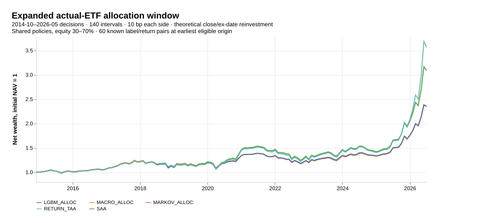
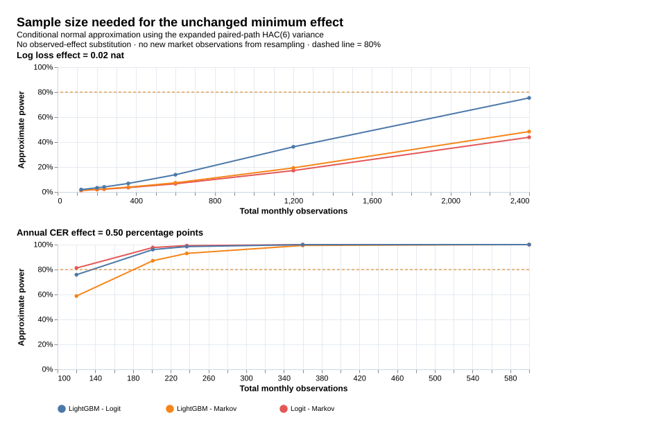

# 검정력 재시도: 확대 실표본과 정밀도

- 연구 ID: `kr-four-regime-power-20261018-v1`, 부모 `kr-four-regime-20261018-v2`. 실행 완료 2026-10-17T21:20:25.136Z.
- 기존 4국면 결과를 이미 본 뒤 설계한 역사적 추가 분석이다. 확대 결과 출력 전에 설계·원천·코드를 고정했다. 새 독립 확인 자료라고 부르지 않는다.
- 현재 트리에는 4국면 연구만 남긴다. 과거 팩터 분석의 실행 경로·설정·문서·결과를 삭제했다. Git 이력은 연구 기록으로 유지한다.

## 실제로 늘린 검증 표본

| 항목 | 기존 참조 | 확대 | 추가 |
|---|---|---|---|
| 첫 완성 아카이브 국면 예측 | 2009-09–2026-05, 201개월 | 2006-09–2026-05, 237개월 | 36개월, 금융위기 포함 |
| 실제 ETF 배분 | 2016-11–2026-05, 115구간 | 2014-10–2026-05, 140구간 | 25구간 |

333개 OECD 판과 동일한 실제 ETF 가격·분배금 스냅샷을 사용했다. 더 앞선 미평가 월을 예측·거래 검증에 포함한 것이며, 일별 가격을 독립 월 표본으로 세거나 상장 전 ETF 수익을 만들지 않았다. 기존 201개 월의 확률·후보·온도는 확대 계산과 정확히 일치했다.

최소 외부 학습을 120→84로 허용하되 실제 최초 적격 월은 지연 라벨과 내부 원점 조건 때문에 87개가 필요했다. 60개 이상으로 학습한 24개 내부 원점을 모두 확보하고 국면별 12개 이상 조건도 유지한다. 배분은 기존 84쌍→60쌍이지만 공분산 60개월·정책 수축 24개월·gamma 5를 유지한다. 분류·정책의 초기 추정 위험이 커질 수 있으며, 확대가 언제나 더 좋은 설계라는 뜻은 아니다.

## 확대 구간 성과

| 국면 | 관측 월 | 에피소드 | 평균 지속 개월 |
| --- | --- | --- | --- |
| goldilocks | 41 | 18 | 2.28 |
| overheat | 70 | 22 | 3.18 |
| recession | 75 | 21 | 3.57 |
| stagflation | 51 | 20 | 2.55 |

월별 관측은 독립 에피소드와 같지 않다. 첫 배분 정책의 국면별 가용 학습 쌍은 0: 8개, 1: 16개, 2: 22개, 3: 14개다. 작은 국면의 평균은 전체 평균으로 수축하며, 확대 구간의 첫 정책 표본이 충분히 정밀하다는 보장은 없다.

| 모형 | N | 로그손실 | Brier | 균형 정확도 |
| --- | --- | --- | --- | --- |
| FREQ | 237 | 1.3930 | 0.7534 | 20.6% |
| PERSIST | 237 | 3.5435 | 1.4756 | 22.3% |
| MARKOV | 237 | 1.4071 | 0.7630 | 21.8% |
| MACRO_LOGIT | 237 | 1.4129 | 0.7662 | 16.6% |
| MACRO_LGBM | 237 | 1.3991 | 0.7588 | 22.3% |

| 전략 | N | 순 CAGR | 연 순 CER | 일별 MDD | 평균 주식 비중 |
| --- | --- | --- | --- | --- | --- |
| SAA | 140 | 10.17% | 6.75% | -20.47% | 50.0% |
| MARKOV_ALLOC | 140 | 7.61% | 5.52% | -19.07% | 41.3% |
| MACRO_ALLOC | 140 | 7.60% | 5.57% | -18.80% | 40.8% |
| LGBM_ALLOC | 140 | 7.63% | 5.63% | -16.39% | 40.7% |
| RETURN_TAA | 140 | 11.54% | 6.93% | -20.99% | 51.2% |

| 비교 | 지표 | 개선 | 12개 보정 95% 구간 |
| --- | --- | --- | --- |
| Logit - Markov | log_loss_improvement | -0.0058 | [-0.0773, 0.0566] |
| Logit - Markov | net_CER_improvement | 0.05%p | [-0.32%p, 0.38%p] |
| LightGBM - Markov | log_loss_improvement | 0.0080 | [-0.0613, 0.0669] |
| LightGBM - Markov | net_CER_improvement | 0.10%p | [-0.34%p, 0.62%p] |
| LightGBM - Logit | log_loss_improvement | 0.0138 | [-0.0401, 0.0676] |
| LightGBM - Logit | net_CER_improvement | 0.06%p | [-0.32%p, 0.48%p] |

개선은 앞 모형이 유리할 때 양수다. 기존 6개+확대 6개 가족에 Bonferroni 보정한다. 기존 가족-6 구간은 원래 설계의 참조값이며 확대안과 유리한 쪽을 골라 결론내리지 않는다. CER과 로그손실의 단위가 다르다. 비용은 편도 10bp다.

## 기존 검정력 계산을 어떻게 보완했나

기존 값은 최초 OOS 전 후보 0·온도 1의 24개월 개발 경로에서 HAC(6) 분산을 추정했다. 작은 표본·고정 후보·한 시기의 변동성에 크게 의존했다. 이번에는 실제 중첩 튜닝으로 산출한 237개 짝지은 월 손실, 140개 배분 수익의 CER 영향함수를 사용한다.

이는 관측 효과를 넣은 사후 검정력이 아니다. 효과는 기존의 **0.02 nat / 연 0.50%p**, alpha 5%, 목표 80%로 고정한다. 12개 가족의 양측 정규 임계값과 z(0.8)를 표준오차에 곱해 MDE를 계산한다. 필요 총 N은 현재 N×(MDE/최소효과)²의 올림이다. [NIST 정규근사식](https://www.itl.nist.gov/div898/handbook/prc/section2/prc222.htm)을 바탕으로 월별 의존성은 HAC로 반영한다. 이 분산을 미래에 대입하는 것에는 정상성 가정이 필요하다. 모형 재선택·재학습 전체 불확실성을 재표집한 결과는 아니다.

| 비교 | 지표 | 확대 N | 80% MDE | 고정 최소효과 | 근사 검정력: 참조→확대 | 필요 총 개월 |
| --- | --- | --- | --- | --- | --- | --- |
| Logit - Markov | log_loss | 237 | 0.0870 | 0.0200 | 1.6%→2.2% | 4490 |
| Logit - Markov | annual_CER | 140 | 0.46%p | 0.50%p | 72.7%→88.2% | 118 |
| LightGBM - Markov | log_loss | 237 | 0.0835 | 0.0200 | 1.8%→2.4% | 4132 |
| LightGBM - Markov | annual_CER | 140 | 0.56%p | 0.50%p | 46.5%→68.0% | 174 |
| LightGBM - Logit | log_loss | 237 | 0.0664 | 0.0200 | 3.1%→4.0% | 2615 |
| LightGBM - Logit | annual_CER | 140 | 0.48%p | 0.50%p | 75.2%→83.8% | 130 |

로그손실의 80% MDE는 0.0664–0.0870 nat로 고정 최소효과 0.02보다 크다. 같은 분산을 가정한 필요 표본 2,615–4,490개월은 현실적인 단일국가 자료 범위를 훨씬 넘는다. 배분은 같은 12개 보정·HAC(6)에서 참조 0/3→확대 2/3개 비교가 80% 근사 기준에 도달했다. 이 숫자는 분산 추정에 조건부이며, MDE 재표집 범위가 효과 기준을 넘는 경우가 있어 보장으로 읽지 않는다.

MDE 막대는 실제 월을 6개월 블록으로 2,000회 재표집한 MDE의 2.5–97.5 분위 범위다. 효과의 신뢰구간과 혼동하지 않는다. 20,000회 성과 구간 재표집이나 2,000회 MDE 재표집은 관측 N을 늘리지 않는다. CER 영향함수의 비선형 근사도 남는다.

## 분산과 블록 길이에 민감한가

| 비교 | 지표 | 분산 구간 | N | HAC(3) MDE | HAC(6) MDE | HAC(12) MDE |
| --- | --- | --- | --- | --- | --- | --- |
| Logit - Markov | log_loss | all | 237 | 0.0880 | 0.0870 | 0.0868 |
| Logit - Markov | log_loss | before_2020 | 160 | 0.0992 | 0.1003 | 0.1026 |
| Logit - Markov | log_loss | from_2020 | 77 | 0.1737 | 0.1666 | 0.1649 |
| Logit - Markov | annual_CER | all | 140 | 0.45%p | 0.46%p | 0.40%p |
| Logit - Markov | annual_CER | before_2020 | 63 | 0.71%p | 0.69%p | 0.55%p |
| Logit - Markov | annual_CER | from_2020 | 77 | 0.56%p | 0.59%p | 0.59%p |
| LightGBM - Markov | log_loss | all | 237 | 0.0776 | 0.0835 | 0.0876 |
| LightGBM - Markov | log_loss | before_2020 | 160 | 0.0898 | 0.0999 | 0.1095 |
| LightGBM - Markov | log_loss | from_2020 | 77 | 0.1470 | 0.1464 | 0.1356 |
| LightGBM - Markov | annual_CER | all | 140 | 0.63%p | 0.56%p | 0.51%p |
| LightGBM - Markov | annual_CER | before_2020 | 63 | 0.55%p | 0.50%p | 0.43%p |
| LightGBM - Markov | annual_CER | from_2020 | 77 | 0.99%p | 0.85%p | 0.79%p |
| LightGBM - Logit | log_loss | all | 237 | 0.0723 | 0.0664 | 0.0605 |
| LightGBM - Logit | log_loss | before_2020 | 160 | 0.0908 | 0.0876 | 0.0788 |
| LightGBM - Logit | log_loss | from_2020 | 77 | 0.1176 | 0.0925 | 0.0960 |
| LightGBM - Logit | annual_CER | all | 140 | 0.53%p | 0.48%p | 0.49%p |
| LightGBM - Logit | annual_CER | before_2020 | 63 | 0.74%p | 0.76%p | 0.80%p |
| LightGBM - Logit | annual_CER | from_2020 | 77 | 0.73%p | 0.58%p | 0.47%p |

| 비교 | 지표 | 블록 | 개선 | 12개 보정 구간 |
| --- | --- | --- | --- | --- |
| Logit - Markov | log_loss_improvement | 3 | -0.0058 | [-0.0796, 0.0566] |
| Logit - Markov | net_CER_improvement | 3 | 0.05%p | [-0.32%p, 0.38%p] |
| LightGBM - Markov | log_loss_improvement | 3 | 0.0080 | [-0.0558, 0.0667] |
| LightGBM - Markov | net_CER_improvement | 3 | 0.10%p | [-0.40%p, 0.66%p] |
| LightGBM - Logit | log_loss_improvement | 3 | 0.0138 | [-0.0449, 0.0725] |
| LightGBM - Logit | net_CER_improvement | 3 | 0.06%p | [-0.38%p, 0.52%p] |
| Logit - Markov | log_loss_improvement | 6 | -0.0058 | [-0.0773, 0.0566] |
| Logit - Markov | net_CER_improvement | 6 | 0.05%p | [-0.32%p, 0.38%p] |
| LightGBM - Markov | log_loss_improvement | 6 | 0.0080 | [-0.0613, 0.0669] |
| LightGBM - Markov | net_CER_improvement | 6 | 0.10%p | [-0.34%p, 0.62%p] |
| LightGBM - Logit | log_loss_improvement | 6 | 0.0138 | [-0.0401, 0.0676] |
| LightGBM - Logit | net_CER_improvement | 6 | 0.06%p | [-0.32%p, 0.48%p] |
| Logit - Markov | log_loss_improvement | 12 | -0.0058 | [-0.0779, 0.0572] |
| Logit - Markov | net_CER_improvement | 12 | 0.05%p | [-0.26%p, 0.36%p] |
| LightGBM - Markov | log_loss_improvement | 12 | 0.0080 | [-0.0626, 0.0701] |
| LightGBM - Markov | net_CER_improvement | 12 | 0.10%p | [-0.27%p, 0.57%p] |
| LightGBM - Logit | log_loss_improvement | 12 | 0.0138 | [-0.0350, 0.0588] |
| LightGBM - Logit | net_CER_improvement | 12 | 0.06%p | [-0.26%p, 0.52%p] |

LightGBM−로짓의 연 CER 개선 상한은 기본 6개월 블록에서 0.481%p지만 3/12개월 블록에서는 각각 0.519/0.515%p다. 따라서 최소효과 0.50%p를 배제한다는 해석도 블록 선택에 견고하지 않다. 로짓−Markov의 상한은 세 블록 모두 0.50%p 아래지만, 이것이 두 모형의 효과가 정확히 같다는 뜻은 아니다.

유리한 시기·HAC 시차·블록 길이를 채택하지 않는다. 검정력 곡선은 전체 구간 HAC(6)을 기본으로 쓰고 분산 구간별 차이를 함께 공개한다. 긴 필요 표본 수는 한 국가·월별 자료에서 정보가 부족함을 보여주는 조건부 설계값이며, 그 기간을 기다리면 효과가 확정된다는 예측이 아니다.

## 정정과 검증

- 정책 gamma/shrink 민감도 인자가 실제 정책 계산에 전달되지 않던 오류를 수정했다. 기본 5/24인 주 분석에는 영향이 없고 보조 정책 민감도는 모두 재계산했다. 실제 시점에서 인자별 정책 계산과 전달 결과를 직접 대조했다.
- 실제 2006-09·2008-09·2026-05에서 로짓/LightGBM을 독립 재적합했다. 최초 확대 원점의 미래 라벨을 바꿔도 확률·후보·온도가 같았다. 모든 비중·비용·NAV 경로를 재생했다.
- [검증 결과](../results/four-regime/power-retry/verification.json), [설계 계약](power_retry_protocol.md), [분산·MDE 전체 CSV](../results/four-regime/power-retry/precision.csv), [표본 크기 곡선](../results/four-regime/power-retry/detection-curves.csv), [월별 확률](../results/four-regime/power-retry/predictions.csv), [월별 배분](../results/four-regime/power-retry/allocation-monthly.csv), [초기 정책 학습 수](../results/four-regime/power-retry/policies.csv), [전체 비교](../results/four-regime/power-retry/comparisons.csv).
- 아카이브 가용일 가정, 최신치인 시장변수, 한 국가·두 ETF, 이미 관찰한 역사, 모형 선택의 불확실성이 남는다. 작은 효과가 없다는 결론이나 충분한 전향 검정력을 확보했다는 인증은 하지 않는다.
