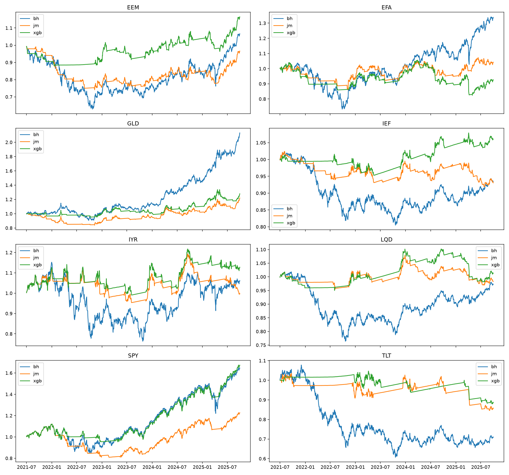

# 원문형 실증 · A51

2021-07-01–2025-09-30, 실제 ETF8개·BIL, 편도5bp. 기존 결과 열람 뒤 계산 정의를 고정한 역사적 분석이다.

51개월 평가의 시작일은 공통 ETF 이력·피처 워밍업과 원문형11년 학습·5년 검증 요건으로 정했다. 학습창을 줄여 확보한141개월 결과는 F141이라는 별도 후속 설계로 보존한다.

ETF와 원문 지수의 구성·현금·체결 조건은 [원문과 ETF의 조건 대응표](paper-comparison.md)에서 확인할 수 있다.

## 원문 표6 대응 · 배분 전후

| 전략 | 연 BIL 초과수익 | 샤프 | 최대낙폭 | Calmar | 실제 종가 위험노출 | 연 비용/NAV |
|---|---:|---:|---:|---:|---:|---:|
| equal_weight | 1.42% | 0.13 | -24.23% | 0.06 | 100.0% | 0.09% |
| ew_jmxgb | -1.21% | -0.19 | -8.85% | -0.14 | 50.9% | 1.78% |
| fix_mix_60_40 | 1.07% | 0.10 | -24.11% | 0.04 | 100.0% | 0.09% |
| minvar | -0.37% | -0.05 | -21.43% | -0.02 | 100.0% | 0.11% |
| minvar_jmxgb | -0.63% | -0.15 | -6.32% | -0.10 | 43.3% | 0.95% |
| mv | 4.15% | 0.30 | -27.40% | 0.15 | 100.0% | 0.10% |
| mv_jmxgb_cap | -1.66% | -0.24 | -9.15% | -0.18 | 47.2% | 1.72% |
| mv_jmxgb_floor | -1.77% | -0.25 | -9.15% | -0.19 | 47.5% | 1.72% |

원문과 같은 수익·샤프·낙폭의 전체 개선 방향은 이 ETF 표본에서 유지되지 않았다. 위험노출 감소와 실제 매매비용을 함께 읽어야 한다. MV 기본/국면형은 위험회피5/10·거래벌점0/1도 달라, XGBoost 단독 효과의 비교가 아니다.

## 원문 표7 대응 · 다음 날 종가 간 수익 상관

| ETF | 기존 EWMA1260 | JM–XGB 약세 하한 | JM–XGB 약세 상한 |
|---|---:|---:|---:|
| EEM | -6.67% | 1.71% | 1.90% |
| EFA | -4.67% | -3.45% | -4.08% |
| GLD | -6.01% | -0.16% | -0.03% |
| IEF | -5.55% | -1.08% | -0.75% |
| IYR | -4.79% | 0.77% | 0.53% |
| LQD | -6.15% | -1.27% | -0.95% |
| SPY | -4.55% | 1.96% | 2.71% |
| TLT | -5.27% | -3.36% | -2.93% |

현금 대피일을 포함한 배분 전 예상수익과 다음 날 실제 DGS3MO 초과수익의 Pearson 상관이다. 원문 Overall의 집계 정의와 같다고 주장하지 않는다. 시가 이후 BIL 초과수익 상관도 전체 CSV로 공개한다.

## 원문 표4 대응 · 개별 ETF

[8개 ETF × B&H·JM 유지·JM–XGB 0/1 전략 전체 성과](../results/redesign/paper_table4.csv). JM 유지 기준은 XGB가 선택한 벌점을 공유하므로 독립적인 ML 단독 효과라고 부르지 않는다.

## 기존 원문 준거 민감도

- [기존 전체 실증](results.md)에는 원문의 발표 평활 반감기 대응, IEF DD 포함, 약세 평균 무제한, 현금 규칙 제거 등 기존 민감도가 보존돼 있다. 원문과 동일한 입력 이력이나 동일 수치를 재현했다는 뜻은 아니다.
- 약세 평균의 하한/상한은 둘 다 본문에 보고한다. 성과가 좋은 해석을 골라 원문형 주 결과로 바꾸지 않는다.

## 진단 실행에서 발견한 검증 문제와 수정

- 첫 D51 계정의 A0 비중 호환 검사가 허용오차를 넘어 중단됐다. 원인은 가격비율과 보유금액의 부동소수점 연산 순서였으며, 기존 비율 우선 계산을 공통 수량 엔진에 적용한 뒤 A0 NAV·목표·거래가 원본과 비트 단위로 일치했다. [실패 기록](../results/redesign/anchor_failure.json) · [정확 일치 증명](../results/redesign/ratio_first_certificate.json)
- 허용오차·모형·배분 조건을 바꾸지 않았다. 첫31개 계정을 [손실 없는 아카이브](../configs/redesign_failed_accounts_snapshot.json)에 보존하고, 동일 예측으로 전체 계정만 재실행했다.
- 독립 재적합 호출의 정수→실수 벌점 변환은 모델ID 직렬화만 바꿨다. 확률·라벨·평균이 정확히 같음을 확인하고 검증 호출에 원래 프로토콜 자료형을 유지했다. [별도 증명](../results/redesign/verification_parameter_proof.json)

## 자료·검증·범위

- [원문 준수 감사](../results/redesign/paper_fidelity_reviewed.json) · [분석 실행 전 계약](../configs/report_analysis_contract.json)
- [독립 계산 검사](../results/redesign/analysis_verification.json) · [배분 성과 전체/30개월/21개월](../results/redesign/paper_table6.csv)
- [개선 방향 판정](../results/redesign/paper_directions.csv) · [IC 전체 날짜·자산·두 목표](../results/redesign/paper_table7.csv)
- Calmar는 연 BIL 초과수익/절대 최대낙폭이라는 적용 규약이다. 일별 샤프와 월 CER를 구분한다.
- 원문형 분석을 먼저 완료한 뒤 [30개 진단 전체 실행·검증](redesign-diagnostics.md)을 추가했다. 최초 보고 단계의 기록은 results/redesign/first_report.json에 보존한다.
