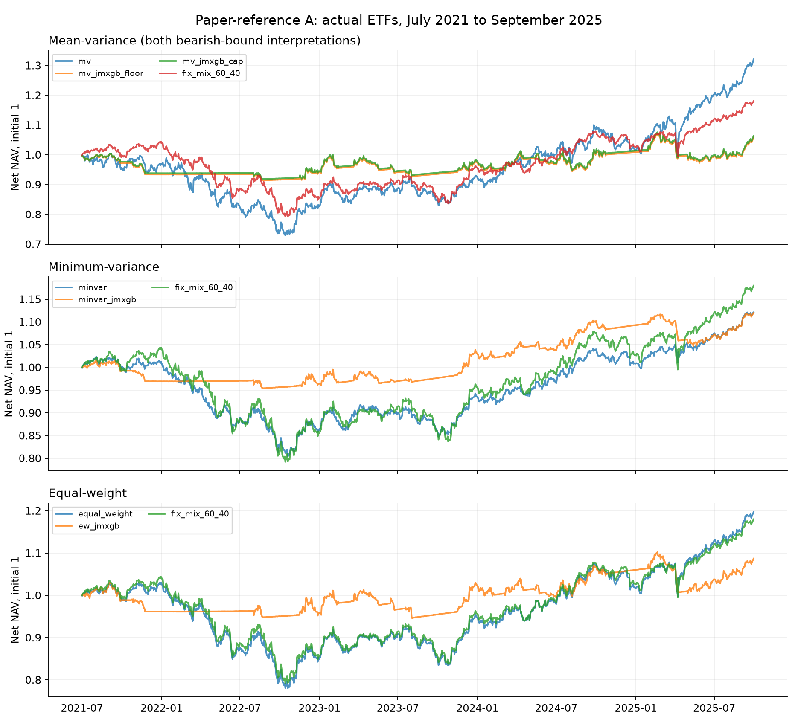
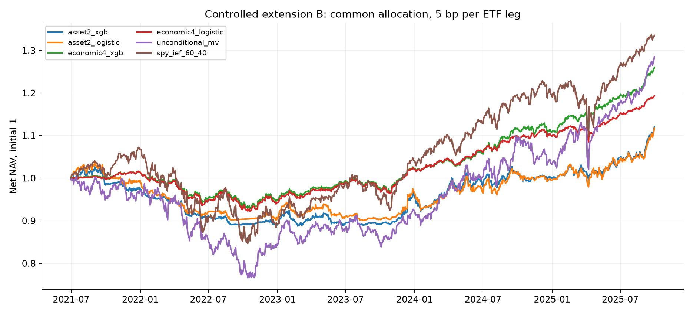
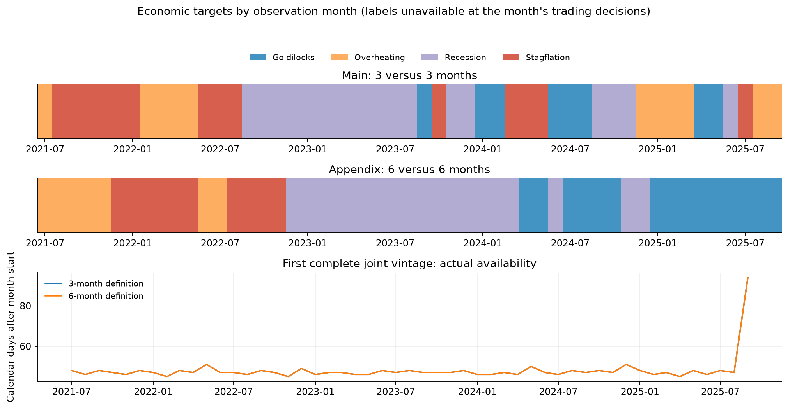
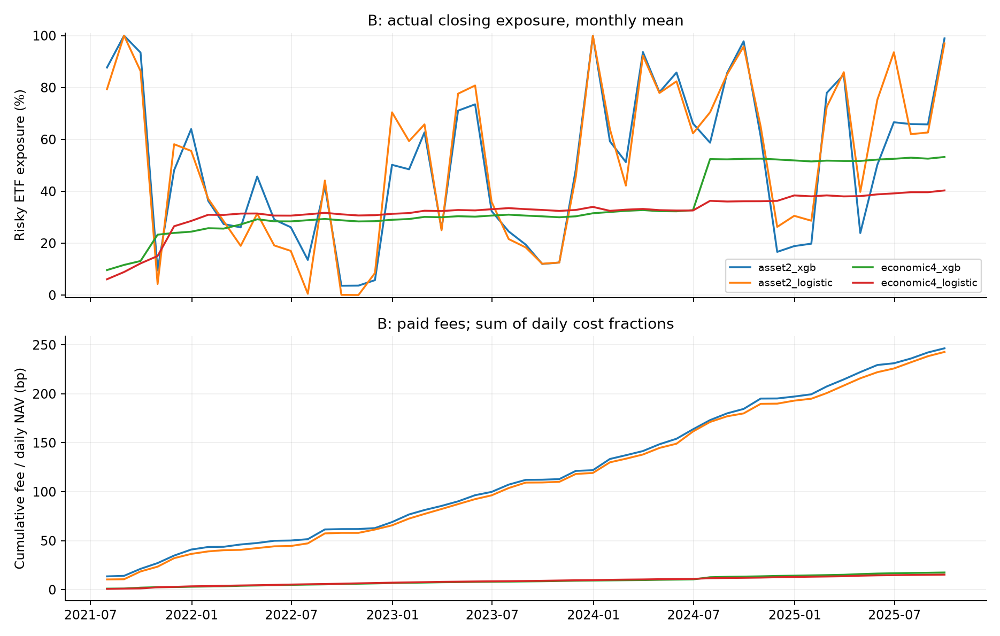

# 원문 조건 준거 실험과 통제 비교

실제 자료 실행과 검증을 통과한 역사적 재분석이다. 이전 결과를 열람한 뒤 설계를 바꿨으며 전향 검증이 아니다.

- 기간: **2021-07-01–2025-09-30, 51개월**. 원문 중첩30개월과 이후 확장21개월을 따로 공개한다.
- 8개 실제 ETF+BIL, 11년 학습·5년 순차 검증·반년 갱신. 상장 전 수익은 만들지 않았다.
- [설계·적용 규약](methodology.md) · [고정 설정](../configs/protocol.json) · [실행 계약](../configs/execution_contract.json)
- 원문의 지수12개·2007–2023 결과와 자산·기간이 다르다. 원문 당시 XGB 버전과 몇몇 세부 규칙도 미확정이다.

## A: 원문 구조를 따른 비교

일별 BIL 초과수익의 연율과 샤프다. 약세 −10bp는 하한/상한 두 해석을 모두 보고하며 유리한 쪽을 고르지 않는다.

| 전략 | 연 초과수익 | 일별 샤프 | MDD | 평균 목표 위험노출 |
|---|---:|---:|---:|---:|
| mv | 4.15% | 0.30 | -27.40% | 100.0% |
| mv_jmxgb_floor | -1.77% | -0.25 | -9.15% | 47.5% |
| mv_jmxgb_cap | -1.66% | -0.24 | -9.15% | 47.2% |
| minvar | -0.37% | -0.05 | -21.43% | 100.0% |
| minvar_jmxgb | -0.63% | -0.15 | -6.32% | 43.3% |
| equal_weight | 1.42% | 0.13 | -24.23% | 100.0% |
| ew_jmxgb | -1.21% | -0.19 | -8.85% | 50.9% |
| fix_mix_60_40 | 1.07% | 0.10 | -24.11% | 100.0% |

원문 표6의 MV 샤프0.37→1.02, MinVar0.70→1.12, EW0.51→0.91과 개선 방향을 대조한다. 위 표의 차이는 점 추정이며 통계적으로 확인한 우위가 아니다. [원문](https://arxiv.org/html/2406.09578v2)

A는 원문대로 기본 MV의 위험회피5·거래벌점0을 국면 MV의10·1로 바꾼다. 평균 추정과 현금 규칙도 달라지므로 개선 전체를 예측 신호의 단독 효과로 해석하지 않는다. 기본 MinVar의 상수 평균10bp는 이번 적용 규약이며 원문의 정확한 기본 상수는 미확정이다. 추정 공분산과 제약은 국면 MinVar와 공유한다.

`fix_mix_60_40`은 존재하는 자산의 원문 슬리브 비중을 정규화한 대체 기준이다. SPY/IEF60/40 및 원문12자산60/40과 구분한다. `single_jm_*`은 JM-XGB와 벌점을 공유하는 온라인 유지 기준선이다.

## B: 국면 정의와 분류기의 통제 비교

두 정의에 공통 입력17개·월별 학습 가중치·평활4일·공통 평균 추정과 배분을 적용한다. 세 대비의 주 지표는 월별 순수익 CER(위험회피5)이다.

| 전략 | CER | CAGR | 일별 샤프 | 연 회전율(양 ETF 다리) | 연 비용/NAV |
|---|---:|---:|---:|---:|---:|
| asset2_xgb | 1.80% | 2.71% | -0.09 | 11.60 | 0.58% |
| asset2_logistic | 1.69% | 2.65% | -0.09 | 11.42 | 0.57% |
| economic4_xgb | 5.00% | 5.58% | 0.50 | 0.83 | 0.04% |
| economic4_logistic | 3.74% | 4.25% | 0.21 | 0.72 | 0.04% |

| 보조 비교군 | CER | CAGR | 일별 샤프 | 실제 종가 위험노출 |
|---|---:|---:|---:|---:|
| equal_weight | 1.33% | 4.32% | 0.13 | 100.0% |
| spy_ief_60_40 | 4.03% | 7.04% | 0.36 | 100.0% |
| unconditional_mv | 3.43% | 6.09% | 0.27 | 89.3% |
| trend | 1.62% | 2.50% | -0.12 | 60.6% |
| bil | 3.37% | 3.43% | 0.00 | 0.0% |

보조 국면 없는 MV의 거래벌점은0이고 네 예측 조합은1이므로, 그 격차를 예측 신호만의 효과로 해석하지 않는다.

| 주요 대비 | CER 차이 | 동시95% 구간 | 판정 | 0.50%p 효과 검정력 |
|---|---:|---:|---|---:|
| asset2_xgb − economic4_xgb | -3.202%p | [-6.863, +0.459]%p | 우위 미확인 | 2.5% |
| asset2_xgb − asset2_logistic | +0.102%p | [-1.706, +1.909]%p | 우위 미확인 | 4.5% |
| economic4_xgb − economic4_logistic | +1.258%p | [-0.241, +2.757]%p | 우위 미확인 | 6.6% |

월 단위 쌍체 원형 블록20,000회, 기본6개월·민감도3/12개월, 세 대비 max-T 동시 보정이다. 경제 라벨 반복이나 ETF 수를 독립 표본 수로 세지 않는다. 유의하지 않으면 우위 미확인이며 동등성·충분한 검정력을 뜻하지 않는다. 경로 재표집은 전체 재학습·설계 수정 불확실성을 포함하지 않는다.

## 진단·민감도·검증

- [원문과 개선 방향·남은 조건 차이](paper-comparison.md) · [기간별 원문 비교](../results/study/paper_comparison.csv) · [설계 연결표](../results/study/design_bridge.csv)
- [모든 요약](../results/study/summary.csv) · [기간 분리](../results/study/subperiods.csv) · [연도별](../results/study/annual.csv)
- [세 대비와 블록 민감도](../results/study/inference.json) · [분류 지표](../results/study/classification.csv) · [모형 입력 중요도](../results/study/feature_importance.csv)
- [단일 클래스 대체·미관측 상태 횟수](../results/study/class_fallbacks.json)를 공개한다. 분류 지표는 각 정의 안에서 빈도·유지 기준과 비교하며 2국면과4국면의 정확도·로그손실을 직접 우열 비교하지 않는다.
- 경제4는 다음 거래일이 속한 관측월의 나중에 발표되는 라벨, 자산2는 고정 JM의 다음 날 온라인 상태를 평가한다. 클래스 수만의 인과효과를 뜻하지 않는다.
- 입력 제거·경제6개월·비용0/10/25bp·단순 배분·현금 규칙, IEF DD 포함·공개 평활·약세 경계 해석을 모두 공개한다. 좋은 부록을 주 결과로 승격하지 않는다.
- 입력 제거는 분류기 블록에 적용하며 기본 선택 JM 라벨을 공유한다. B의 보조 국면 없는 MV는 EWM1260 평균·위험회피10·거래벌점0이며, 네 주요 예측 조합은 모두10·1이다.
- A→현금 제거→공통 평균→B의 변화는 일부 묶음 효과를 포함한다. 조건별 원인을 단독으로 확정하지 않는다.
- 미래 정답과 평균 노출 맞춤은 사후 진단이며 실시간 전략으로 제시하지 않는다. 입력 중요도는 인과적 기여가 아니다.
- 실제 원자료 검증: 독립 적합59건, 전체 계정120개 독립 재생, 미래 가격·시장자료·빈티지·미발표 라벨·튜닝·체결 검사 통과.
- [검증 기록](../results/study/verification.json) · [실행 기록](../results/study/run.json)









## 재현

```bash
uv sync --frozen --python 3.12
uv run etf-study acquire
uv run etf-study run --workers 4
uv run etf-study verify
uv run etf-study report
uv run etf-study verify --artifacts-only
```

기존 계약을 재현할 때 `audit --freeze`로 계약을 덮어쓰지 않는다. 새 자료·설정은 별도 계약과 결과 경로에서 연구한다.
