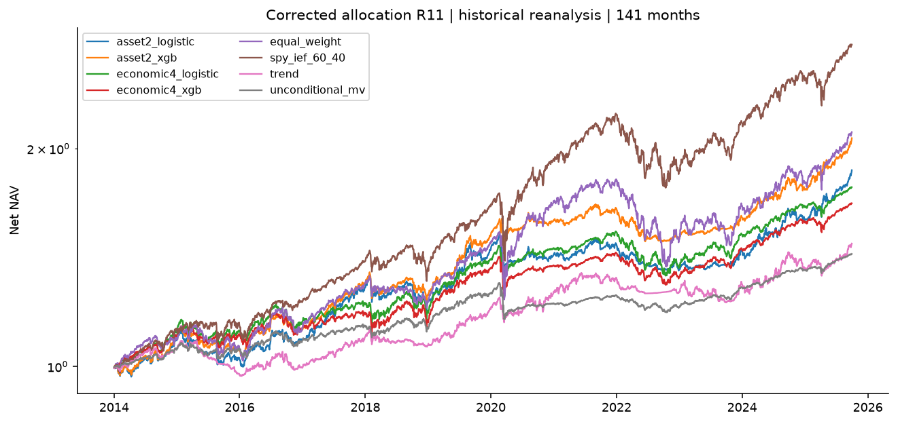
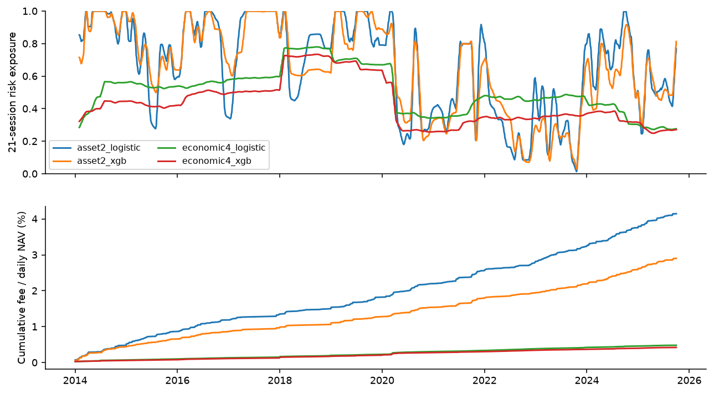
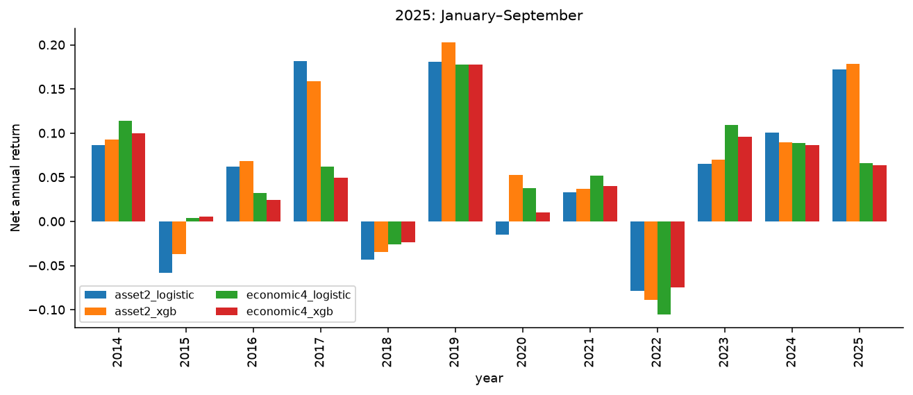

# v2 배분 수식 수정과 역사적 재분석

수정판 실제 원자료 검증 통과. 기간 2014-01-02–2025-09-30, 연속 141개월. v1 성과를 확인한 뒤 수행한 수정 재분석이다. 수익 개선을 성공 조건으로 삼지 않았다.

## 수정과 유지

v1의 이차항 계수는 실제 5였고 거래 벌점이 없었다. R11은 일별 `mu'w − 10*w'Sigma*w − 1*0.0005*||w−w_signal_close||1`을 사용한다. 벌점은 위험 ETF 8개, 실제 체결비용은 BIL 포함 9개다. 매 판단은 해당 계정의 실제 종가 비중을 받고 다음 시가를 보기 전에 결정한다. 목적함수 비용항을 NAV에서 다시 차감하지 않는다.

R00=위험5/거래0, R10=10/0, R01=5/1, R11=10/1을 고정했다. R00의 v1 비중·NAV 재현 검사를 통과한 다음 나머지를 계산했다. [영향 분리표](../results/v2/correction_effects.csv), [모든 조건 지표](../results/v2/correction_arms.csv), [v1/v2](../results/v2/v1_v2.csv), [검사 오차](../results/v2/r00_gate.json).

ETF·141개월·5년/3년·17개 입력·고정 소형 XGB·월 가중·4일 평활·확률 혼합·12개월 축소·CER gamma5는 유지했다. 주 비교에는 강제 현금 대피를 넣지 않았다. [원문 대조표](paper_implementation_audit_v2.md), [수정 계약](../configs/correction_v2.json).

## 주 결과: R11, 실제 편도 5bp

| 전략 | CER | CAGR | 샤프 | MDD | 위험노출 | 연 회전율 | 연 비용/NAV |
| --- | --- | --- | --- | --- | --- | --- | --- |
| 로지스틱 2국면 | 4.42% | 5.46% | 0.59 | -14.89% | 66.5% | 7.05 | 0.35% |
| XGB 2국면 | 5.44% | 6.38% | 0.78 | -11.16% | 65.1% | 4.94 | 0.25% |
| BIL | 1.61% | 1.63% | 0.00 | -0.24% | 0.0% | 0.00 | 0.00% |
| 로지스틱 4국면 | 4.09% | 4.98% | 0.55 | -13.18% | 50.7% | 0.82 | 0.04% |
| XGB 4국면 | 3.82% | 4.52% | 0.54 | -11.13% | 43.4% | 0.72 | 0.04% |
| 동일가중 | 4.56% | 6.56% | 0.55 | -24.23% | 100.0% | 1.47 | 0.07% |
| SPY/IEF 60/40 | 7.00% | 9.11% | 0.81 | -21.06% | 100.0% | 1.14 | 0.06% |
| 단순 추세 | 2.72% | 3.39% | 0.34 | -10.63% | 65.8% | 18.18 | 0.91% |
| 국면 없는 MVO | 2.77% | 3.10% | 0.40 | -10.89% | 28.9% | 0.48 | 0.02% |

## 사전 고정한 세 대비

| 비교 | 연 CER 차이 | 동시 95% 구간 | 판정 | 고정효과 검정력 |
| --- | --- | --- | --- | --- |
| XGB 2국면 − XGB 4국면 | +1.614%p | [-0.932, +4.161]%p | 우위 미확인 | 3.0% |
| XGB 2국면 − 로지스틱 2국면 | +1.017%p | [-0.657, +2.691]%p | 우위 미확인 | 5.5% |
| XGB 4국면 − 로지스틱 4국면 | -0.264%p | [-1.075, +0.548]%p | 우위 미확인 | 17.6% |

v1의 XGB2−XGB4는 −4.197%p였고, 수정판은 +1.614%p로 부호가 바뀌었다. **v1의 경제 4국면 우위 판정을 수정한다.** 수정판 세 주 비교는 모두 우위 미확인이다. 수식 오류가 비교 결과에 큰 영향을 주었으며 예측·라벨을 바꾸어 얻은 개선이 아니다.

월별 쌍체 원형 블록 20,000회, 기본 6개월·민감도 3/12개월. 최대 절대 표준화 오차로 세 구간을 함께 보정한다. 미확인은 동등성이나 충분한 검정력을 뜻하지 않는다. 고정 효과는 연 CER +0.50%p이고 분산 불확실성 범위는 각 inference.json에 기록한다. 경로 재표집은 전체 재학습·버전 수정 선택 불확실성을 포함하지 않는다.

## 고정 부록과 진단

[모든 수정 조건·영향 분리·비용·고정 부록의 읽기 쉬운 표](appendix_v2.md).

- [운영 비용·단순 배분·현금·oracle·노출·9ETF 벌점·원문 배분 대조 전체](../results/v2/main/summary.csv). 운영 비용은 최적화와 체결을 0/5/10/25bp로 함께 바꾸어 처음부터 각 계정을 실행했다. `fee_only`는 기본 5bp 목표를 고정해 실제 비용만 바꾼 별도 진단이다.
- [수익 입력 제거](../results/v2/without_returns/summary.csv), [시장 입력 제거](../results/v2/without_market/summary.csv), [경제·시차 제거](../results/v2/without_macro/summary.csv), [경제 6개월](../results/v2/macro6/summary.csv). 각 부록의 세 대비는 내부에서 함께 보정하며 새 주 결과로 승격하지 않는다.
- `paper_hard_*`는 경성 0.5 상태·당시 학습 Jump 라벨로 구한 비가중 비축소 평균·강세≤3 현금 규칙의 ETF 적용 대조다. 원문의 −10bp cap 방향을 확정하지 못해 무경계·하한·상한을 모두 공개한다. **원문 전체 재현을 주장하지 않는다.** 8개/12개, BIL 현금, 5년/3년, 예측 설정 차이가 남는다. [평균 추정 근거](../results/v2/hard_mean_provenance.json).
- `oracle`과 `exposure_matched`는 미래 정보·사후 노출을 쓰는 거래 불가 진단이다. oracle은 성과 상한이나 순수 예측 효과가 아니다.
- [2024–2025-09 확장 21개월](../results/v2/main/extension_2024_onward.csv)은 원문 표본 이후 역사적 확장이다. 미열람 전향 검증이 아니다.
- 분류 예측·국면 타임라인·입력 기여도는 변경하지 않았으며 [원본 예측](../results/main/predictions.parquet), [분류 평가](../results/main/classification.csv), [입력 기여도](../results/main/input_importance.csv), [그림](../results/main/figures/)의 해시와 원래 모델 ID를 보존했다. 두 정의의 정확도·로그손실을 직접 비교하지 않는다.

## 검증·재현

[실제 원자료 검증](../results/v2/verification.json): 대표 세 시점 48개 자산/정의 재적합(96개 분류기), 미래 가격·빈티지·미발표 라벨 교란, 수정 계정 판단의 다음 시가 교란, 모든 108개 거래 경로 독립 shares+근 찾기 재생. [실행 소스·원본 예측 해시](../results/v2/run.json), [산출물 해시](../results/v2/artifact_manifest.json).

`uv sync --frozen --python 3.12` → `uv run etf-study acquire` → `uv run etf-study audit` → `uv run etf-study run --revision v2` → `uv run etf-study verify --revision v2` → `uv run etf-study report --revision v2`. [정확한 실행 소스 bundle·파일 포장·v1 보존판 명령](reproduction_v2.md). 원본 예측 재생은 저장된 파일을 재사용하며 독립 재학습으로 확인한다.

